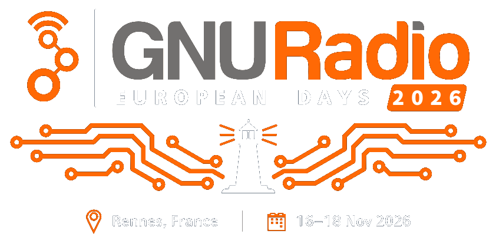
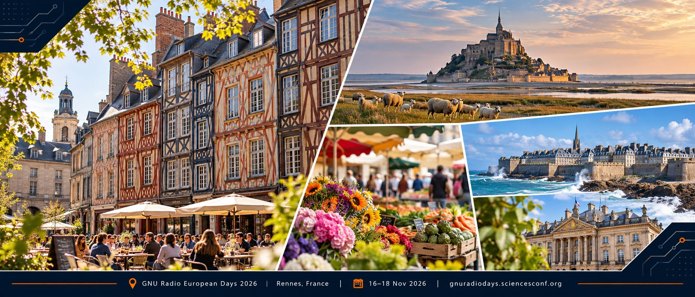

<p align="center"></p>

# Beams, Echoes and Spectra
## _From wartime navigation and radar to particle accelerators and software-defined radio_

The slides are live at [https://ralphsteinhagen.github.io/talk-beams-echos-spectra/](https://ralphsteinhagen.github.io/talk-beams-echos-spectra/) and PDFs etc. 
<!--[here](--link to zenodo--)-->.

<!-- the DOI badge, once `scripts/zenodo_talks.py reserve` has reserved it (zenodo.yml):
[](https://doi.org/10.5281/zenodo.NNNNNNNN) -->

**European GNU Radio Days 2026**, Rennes, France — Monday, 16 November 2026, 14:30, Methodology session; a 30-minute
talk. Ralph J. Steinhagen, GSI/FAIR Darmstadt.

Radar, telecommunications and particle accelerators share a surprisingly intertwined history. From Bragg's
sound-ranging and Widerøe's RF accelerator through the "Battle of the Beams", radar, magnetrons and klystrons, ideas,
people and technologies repeatedly moved between scientific and engineering domains.

This talk uses that history to explore a present-day problem: many fields still solve closely related problems —
timing, filtering, coherent detection, feedback, spectral estimation and control — but often with different
terminology and tools.

Can a more common language, shared software-defined tools such as GNU Radio 4, and stronger teaching of
signal-processing and control fundamentals help the next generation of scientists and engineers collaborate across
these boundaries rather than repeatedly reinventing the same solutions?

**Live slides:** [https://ralphsteinhagen.github.io/talk-beams-echos-spectra/](https://ralphsteinhagen.github.io/talk-beams-echos-spectra/)
— in the full gr4-present viewer, so the four experiments run live, GNU Radio 4 and OpenDigitizer in the browser.

## The deck

`talk.md` is a [gr4-present](https://github.com/RalphSteinhagen/gr4-present) deck (`entry:` in `index.yml`): 25
slides and the references, then two backups. The arc: Maxwell and Hertz, the Braggs and X-rays → 1914–1918, a real
problem (where is that gun?) → experiments 1 and 2, sound ranging and Tucker's microphone live → one problem, many
disguises → Widerøe, the betatron, radio navigation, the "Battle of the Beams", signals you did not mean to send →
pulses or spectra, experiment 3 (a tuning fork's phase) → the klystron loop, the people → Schottky noise, the MIM,
experiment 4 (a chirp below the noise) → not a tree but a braid → learn from it twice. Speaker notes are in each
slide's `:::notes`; historical claims are cited, or marked `[verify]` there.

```bash
./serve.sh            # serves this folder on :8000 and opens a viewer on it
./serve.sh -p 8001    # another port; --no-open only serves
```

The live regions of the experiment slides need a viewer built with OpenDigitizer: the pinned one of the live slides
(`viewer:` in `zenodo.yml`), or gr4-present's public full viewer,
`https://ralphsteinhagen.github.io/gr4-present/?presentation=http://localhost:8000` (a local `WASM-Minimal` build draws
an empty frame). Chrome asks once for *Local network access* to `localhost`; allow it (the lock icon in the address
bar). *Load* in the viewer's side menu (`Ctrl+O`) opens the folder from disk instead; tick *follow edits* to reload on
every change. Present fullscreen (F11) in the viewer's dark theme: the layout is exact at 16:9.

**The four microphones.** Experiments 1 and 3 (slides `exp1`, `exp2`) start on a simulated source (OpenDigitizer's
PointSourceAudio), experiment 2 (slide `lowpass`) on the microphones; the toolbar's `input` switches between them,
experiment 4 plays its recorded take. The spacing is a toolbar choice too, `spacing`: 1 m (the talk, a 3 m line) or
0.2 m (a desk); `python3 devtools/make-workflows.py --spacing 0.2` makes 0.2 m the default for testing — regenerate
without the option before the talk. The browser captures at most two channels per audio source, so before the talk
(and after every login or re-plugging) split the 4-channel interface (here a Behringer UMC404HD, PipeWire profile
"Pro Audio") into two stereo sources, then allow the microphone when Chrome asks and pick `BEAMS_PAIR_A` in `input`
(`pair B` already names `BEAMS_PAIR_B`; slide `lowpass` starts on it):

```bash
devtools/four-mics-browser-pairs.sh setup    # BEAMS_PAIR_A = inputs 1, 2; BEAMS_PAIR_B = inputs 3, 4
devtools/four-mics-browser-pairs.sh status
devtools/four-mics-browser-pairs.sh revert   # afterwards: back to the default set-up
```

## Layout

| path | content |
| --- | --- |
| `index.yml`, `talk.md` | the deck: masters, fonts and sizes once, then one `#` heading per slide, `:::notes` with bullet cues |
| `figures/` | the chalkboard masters (`devtools/make-masters.py`, from tables in cm, the board texture `chalk-*.jpg` embedded), the diagrams (`devtools/make-figures.py`) and the title panorama (`devtools/make-montage.py`) |
| `media/` | photographs, drawings, the Armistice clip and the portraits (`media/portraits/`), each with its source and licence in `media/CREDITS.md` or `media/portraits/PORTRAITS.md`; on a slide a picture carries only its reference number |
| `fonts/`, `effects/` | Patrick Hand and Patrick Hand SC (SIL Open Font License); the GREMLIN slide's wave-packet background |
| `workflows/*.grc` | the live `:::gr4` regions, from `devtools/make-workflows.py`: `exp1-claps`, `exp1b-lowpass`, `exp2-noise-tone` (the simulation or the microphones, 96 kS/s), `exp6-chirps` (the matched filter, 48 kS/s: the recorded take from `devtools/make-demo-data.py`, or the live ping and its echoes) |
| `devtools/` | the generators above, `serve.mjs` (gr4-present's server), `shoot.mjs` (screenshots at 1600×900), `check-workflows.py` (every workflow parameter against its block's settings, since GR4 drops an unknown one silently), `four-mics-browser-pairs.sh` |
| `zenodo.yml`, `scripts/`, `viewer/` | the Zenodo record of the talk and its tools; the viewer pin of the live slides (below) |
| `.github/workflows/` | `pages.yml` (the live slides), `zenodo-talks.yml` (the Zenodo record) |
| `CLAUDE.md` (`AGENTS.md`), `CORE_*.md`, `.claude/commands/` | guidance for coding agents: GR4's rules, as in OpenDigitizer |

## Archiving on Zenodo

The talk gets its own Zenodo DOI (type *presentation*), as the talks of [fair-acc/gremlin](https://github.com/fair-acc/gremlin/tree/main/talks)
do. Tools: [`scripts/zenodo_talks.py`](scripts/zenodo_talks.py), [`scripts/talk_pdfs.sh`](scripts/talk_pdfs.sh),
[`scripts/update_viewer.sh`](scripts/update_viewer.sh), workflow [`zenodo-talks.yml`](.github/workflows/zenodo-talks.yml).

1. **Describe:** `zenodo.yml` holds title, description, date and conference; creators and keywords come from
   `.zenodo.json`. Check: `scripts/zenodo_talks.py plan`.
2. **Reserve the DOI** (token below), commit `zenodo.yml`:
   ```bash
   scripts/zenodo_talks.py reserve
   ```
   Put the DOI on the title slide, in this README (the badge above) and in `CITATION.cff` (`preferred-citation`).
3. **PDFs** (stored on Zenodo only, never in git), when the talk is final and committed:
   ```bash
   scripts/talk_pdfs.sh                 # to ~/.cache/beams-echoes-talks/<name>/, check them
   scripts/zenodo_talks.py upload       # into the reserved draft; commit zenodo.yml (pdfs_from)
   ```
   Needs a native gr4-present build with OpenDigitizer of the pinned viewer's commit (`GR4_PRESENT_BIN`). A later
   deck change makes them stale: export and upload again.
4. **Push** to `main`: the Pages workflow deploys the live slides (Settings → Pages → Source: *GitHub Actions*). The
   Zenodo record links them as `…/viewer/<viewer>/?presentation=../../default`.
5. **Publish** before the talk (a reserved DOI does not resolve yet): the next GitHub release, or Actions → *Archive
   the talk on Zenodo* → mode `publish`, *sandbox* unticked. The record links this repository, so make it public
   first.
6. **Verify** `https://doi.org/<doi>`: two PDFs, the deck zip, the live-slides link.

Optional dry run on sandbox.zenodo.org: add `--sandbox` to `reserve`/`upload`/`publish`. Never cite a sandbox DOI. A
publish is permanent; a published talk is skipped on later runs.

**The viewer.** The live slides open in a pinned gr4-present web viewer, so a later gr4-present cannot change how
the published talk looks. gremlin keeps its (minimal) viewer in git; this deck needs the full one (live GNU Radio 4
and OpenDigitizer), whose `index.wasm` (~190 MB) exceeds GitHub's 100 MB file limit. So git keeps the pin only,
`viewer/<commit>/VERSION` (release, commit, the archive's SHA-256), and the Pages workflow fetches that release at
deploy time and refuses any other build:

```bash
scripts/update_viewer.sh               # gr4-present's latest full viewer, pinned in viewer/<commit>/VERSION
scripts/update_viewer.sh v0.2.0 full   # a tagged release
```

Name the folder as `viewer: "<commit>"` in `zenodo.yml` once the deck looks right in it; remove a pin once nothing
names it. `latest` is rebuilt in place, so its pin holds only until gr4-present's next build: pin a tagged release
for the published talk.

**Tokens.** Zenodo → Applications → **Personal access token** (not *Developer application*), scopes
`deposit:write` and `deposit:actions`; one on [zenodo.org](https://zenodo.org/account/settings/applications/tokens/new/),
one on [sandbox.zenodo.org](https://sandbox.zenodo.org/account/settings/applications/tokens/new/).

- CI: `gh secret set ZENODO_TOKEN -R RalphSteinhagen/talk-beams-echos-spectra` (and `ZENODO_SANDBOX_TOKEN`).
- Locally, paste at the silent prompt, then Enter:
  ```bash
  read -rsp 'Zenodo token: ' ZENODO_TOKEN && export ZENODO_TOKEN
  scripts/zenodo_talks.py check
  ```
- Never put a token on a command line, in a file, an issue or a chat.

## License and Copyright

Unless otherwise noted:<br>
`SPDX-License-Identifier: CC-BY-4.0` (the slides and their documentation) &<br>
`SPDX-License-Identifier: LGPL-3.0-or-later WITH LGPL-3.0-linking-exception` (`scripts/`, `devtools/`) &<br>
`SPDX-License-Identifier: GPL-3.0-or-later` (`devtools/serve.mjs` and the gr4-present viewer)

Third-party pictures keep their own terms (`media/CREDITS.md`, `media/portraits/PORTRAITS.md`); the fonts are under
the SIL Open Font License (`fonts/*-OFL.txt`). Licence texts: `LICENSE` (CC-BY-4.0) and `LICENSES/`.

Copyright © GSI Helmholtz Centre for Heavy Ion Research, Darmstadt, Germany<br>
Copyright © FAIR — Facility for Antiproton and Ion Research in Europe, Darmstadt, Germany

<p align="center"></p>
