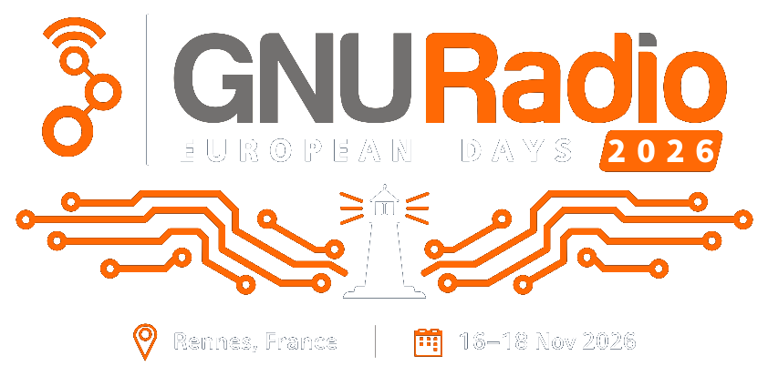
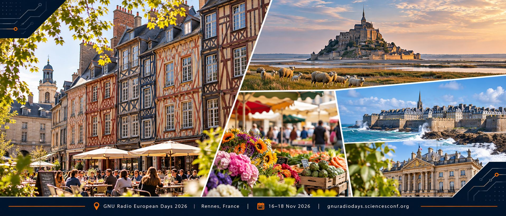

<p align="center"></p>

# Beams, Echoes and Spectra
## _From wartime navigation and radar to particle accelerators and software-defined radio_

The slides are live at [https://ralphsteinhagen.github.io/talk-beams-echos-spectra/](https://ralphsteinhagen.github.io/talk-beams-echos-spectra/) and PDFs etc. [here](https://doi.org/10.5281/zenodo.24263044).

[](https://doi.org/10.5281/zenodo.24263044)

**European GNU Radio Days 2026**, Rennes, France — Monday, 16 November 2026, 14:30, Methodology session; a 30-minute
talk. Ralph J. Steinhagen, GSI/FAIR Darmstadt.

Radar, telecommunications and particle accelerators share a surprisingly intertwined history. From Bragg's
sound-ranging and Widerøe's RF accelerator through the "Battle of the Beams", radar, magnetrons and klystrons, ideas,
people and technologies repeatedly moved between scientific and engineering domains.

This talk uses that history to explore a present-day problem: many fields still solve closely related problems —
timing, filtering, coherent detection, feedback, spectral estimation and control — but often with different
terminology and tools.

Can a more common language, shared software-defined tools such as GNU Radio 4, and stronger teaching of
signal-processing and control fundamentals help the next generation of scientists and engineers collaborate across
these boundaries rather than repeatedly reinventing the same solutions?

## Showing the talk

`talk.md` is a [gr4-present](https://github.com/RalphSteinhagen/gr4-present) deck: 21 slides, then the backups and the
references; the speaker notes are in each slide's `:::notes`.

```bash
./serve.sh                    # serves this folder on :8000 and opens a viewer on it
devtools/present-offline.sh   # without a network: the pinned viewer and this deck on :8090
```

Present fullscreen (F11) in the viewer's dark theme. Setting up the live demonstrations (microphones, acoustic camera,
FM radio) and a local viewer for a slow network: [`devtools/README.md`](devtools/README.md); archiving on Zenodo:
[`scripts/README.md`](scripts/README.md).

## License and Copyright

Unless otherwise noted:<br>
`SPDX-License-Identifier: CC-BY-4.0` (the slides and their documentation) &<br>
`SPDX-License-Identifier: LGPL-3.0-or-later WITH LGPL-3.0-linking-exception` (`scripts/`, `devtools/`) &<br>
`SPDX-License-Identifier: GPL-3.0-or-later` (`devtools/serve.mjs` and the gr4-present viewer)

Third-party pictures keep their own terms (`media/CREDITS.md`, `media/portraits/PORTRAITS.md`); the fonts are under
the SIL Open Font License (`fonts/*-OFL.txt`). Licence texts: `LICENSE` (CC-BY-4.0) and `LICENSES/`.

Copyright © GSI Helmholtz Centre for Heavy Ion Research, Darmstadt, Germany<br>
Copyright © FAIR — Facility for Antiproton and Ion Research in Europe, Darmstadt, Germany

<p align="center"></p>
