# {#title master=title}

:::place
ttl: 0.0357 0.0300 0.6700 0.1500
sub: 0.0357 0.1800 0.6700 0.1300
pano: 0.0200 0.3200 0.9600 0.5947
byline: 0.0357 0.9161 0.6000 0.0650
:::

:::layout
logo: media/gnuradiodays-2026-banner-cutout.webp
:::

:::ttl {notes=off size=480%}
**Beams, Echoes and Spectra**
:::

:::sub {notes=off size=180%}
*From wartime navigation and radar to particle accelerators* *and software-defined radio*
:::

:::byline {size=130% centre}
[**Ralph J. Steinhagen, GSI/FAIR, Darmstadt, Germany**]{colour=#ffff00}
:::

:::pano {notes=off fit}

:::

:::notes
- (40 s, off by 00:40)
- lead-in: Hello, I'm Ralph Steinhagen, from GSI/FAIR in Darmstadt.
- What do an ammunition box from 1916, GPS and the LHC have in common?
- They all solve the same few problems: where is it, when did it happen, and is there a signal in this noise?
- Different fields solved them again and again, under different names. Sometimes an idea was carried over, sometimes it was found twice, independently, and sometimes it is just the same maths.
- [optional] The pictures behind me run from 1912 to today, from grey to colour.[^ph-panorama]
- bridge: But it starts on paper, in 1865.
:::

# The Birth of RF Maxwell predicts, Hertz measures — a wave becomes an instrument {#hertz master=people}

:::place
mxhead: 0.0357 0.1250 0.3600 0.0600
maxwell: 0.0357 0.1950 0.3600 0.6200
p1: 0.8607 0.0190 0.1143 0.2950
hzhead: 0.4063 0.1250 0.4366 0.0600
engraving: 0.4063 0.1950 0.1875 0.3200
photo: 0.5938 0.1950 0.2500 0.3200
caption: 0.4063 0.5050 0.4366 0.0400
light: 0.4063 0.5500 0.4366 0.1000
useless: 0.4063 0.6550 0.4366 0.0450
quote: 0.4622 0.6950 0.3800 0.1300
marconi: 0.5188 0.8350 0.3244 0.0450
p2: 0.8607 0.3222 0.1143 0.2950
:::

:::mxhead {notes=off size=110%}
**1865: Maxwell predicts RF waves — on paper**[^maxwell]
:::

:::maxwell {notes=off fit}
$$
\begin{gathered}
\begin{aligned}
& \text{\tiny Gauss' law for electricity:} & \nabla \cdot \mathbf{D} &= \rho \\
& \text{\tiny Gauss' law for magnetism:} & \nabla \cdot \mathbf{B} &= 0 \\
& \text{\tiny Faraday's law of induction:} & \nabla \times \mathbf{E} &= -\frac{\partial \mathbf{B}}{\partial t} \\
& \text{\tiny Ampère's law:} & \nabla \times \mathbf{H} &= \mathbf{J} + \frac{\partial \mathbf{D}}{\partial t} \\
& \rule{0pt}{1.8em}\text{\tiny material equations:} & &
\end{aligned} \\
\scalebox{0.75}{\displaystyle \mathbf{D} = \varepsilon_0 \mathbf{E} + \mathbf{P} \qquad \mathbf{H} = \frac{1}{\mu_0} \mathbf{B} - \mathbf{M}}
\end{gathered}
$$
:::

:::p1 {notes=off size=40% fit}
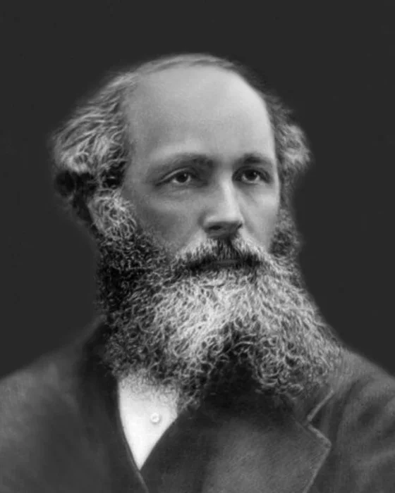

[**James Clerk Maxwell**]{size=205%} [1831–1879]{size=205%}
:::

:::step

:::p2 {notes=off size=40% fit}
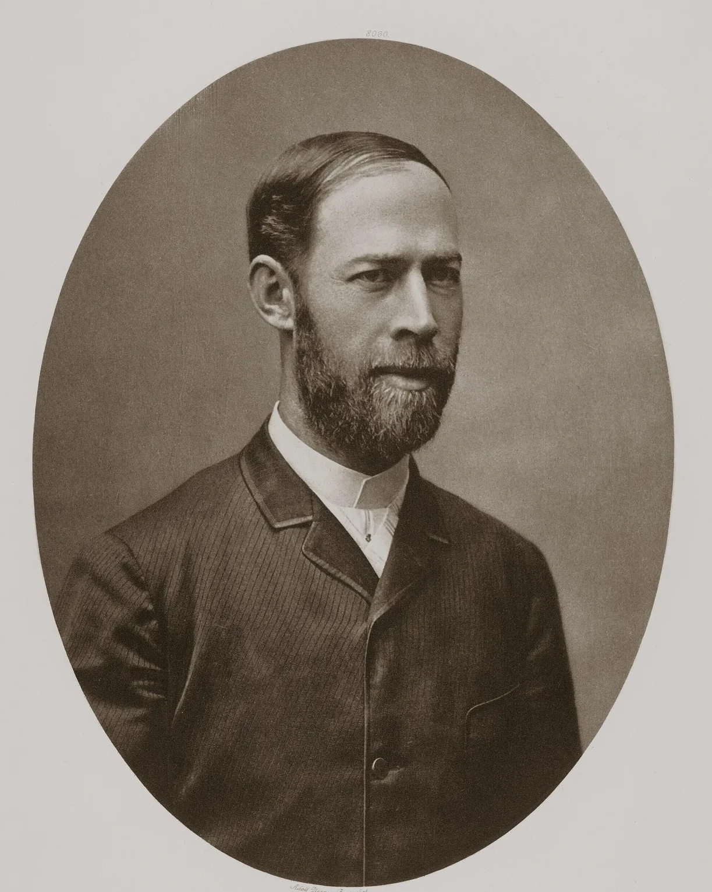

[**Heinrich Hertz**]{size=205%} [1857–1894]{size=205%}
:::

:::hzhead {notes=off size=110%}
**1887, Karlsruhe: Hertz makes them — sees sparks across the room**[^hertz]
:::

:::engraving {notes=off fit}
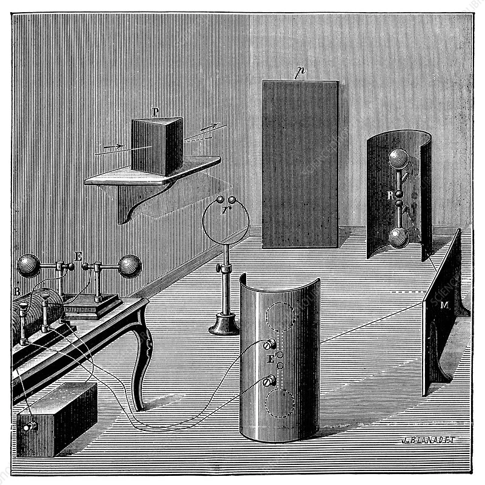
:::

:::photo {notes=off fit}
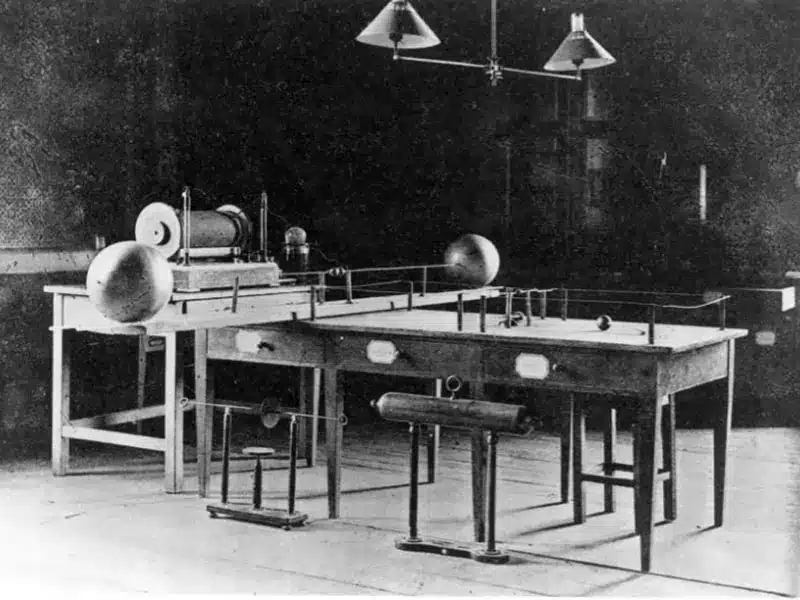
:::

:::caption {notes=off size=caption}
battery, coil, spark gap, mirrors, prism, resonator[^ph-spl] — and the apparatus itself[^ph-hertzlab]
:::

:::light {notes=off}
- measured like light: wavelength, reflection, refraction, polarisation, interference — and **characterised by resonance**
:::

:::step

:::useless {notes=off}
- his conclusion, as the story goes:
:::

:::quote {notes=off size=225%}
"It's of no use whatsoever"
:::

:::marconi {notes=off}
— Marconi and Tesla, ten years later …
:::

[^maxwell]: J. C. Maxwell, "A dynamical theory of the electromagnetic field," *Phil. Trans. R. Soc. Lond.*, vol. 155, pp. 459–512, 1865.
[^hertz]: H. Hertz, *Electric Waves: Being Researches on the Propagation of Electric Action with Finite Velocity Through Space*, transl. D. E. Jones. London: Macmillan, 1893.

:::notes
- (50 s, off by 01:30)
- lead-in: In 1865 Maxwell predicted electromagnetic waves, on paper.
- Twenty years later, in Karlsruhe, Hertz made them. He saw sparks jump across the room and measured the waves like light: reflection, refraction, polarisation.
- If you look at his bench, the whole RF chain is already there: generate, propagate, detect, resonate.
- (click) And his conclusion, as the story goes: it's of no use whatsoever.
- (click) Ten years later, Marconi and Tesla thought otherwise.
- bridge: Twenty-five years on, the same wave physics was used to read a crystal.
:::

# Laue Sees Spots, the Son Interprets, the Father Measures X-rays and crystals, Munich, Leeds and Cambridge, 1912–1915 {#xrays master=people}

:::place
h1: 0.0357 0.1250 0.2063 0.0450
laueimg: 0.0357 0.1700 0.1763 0.3160
laueapp: 0.0357 0.4900 0.1763 0.4030
l1: 0.0357 0.8760 0.2063 0.0560
p1: 0.8607 0.0190 0.1143 0.2850
h2: 0.5550 0.1250 0.2881 0.0450
spectro: 0.5550 0.1700 0.2431 0.4550
measure: 0.5550 0.6089 0.2431 0.2711
c2: 0.5550 0.8700 0.2881 0.0350
p2: 0.8607 0.5970 0.1143 0.2850
h3: 0.2544 0.1250 0.2881 0.0450
schematic: 0.2544 0.1700 0.2881 0.3667
l3: 0.2544 0.5400 0.3000 0.2400
p3: 0.8607 0.3080 0.1143 0.2850
nobel: 0.0357 0.9350 0.8072 0.0550
m1: 0.9538 0.2322 0.0350 0.0622
m2: 0.9538 0.5211 0.0350 0.0622
m3: 0.9538 0.8100 0.0350 0.0622
:::

:::p1 {notes=off size=40% fit}
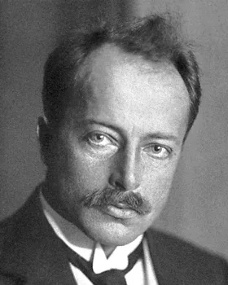

[**Max von Laue**]{size=205%} [1879–1960]{size=205%}
:::

:::h1 {notes=off size=110%}
**1912: X-Rays through a Crystal**
:::

:::laueimg {notes=off fit}
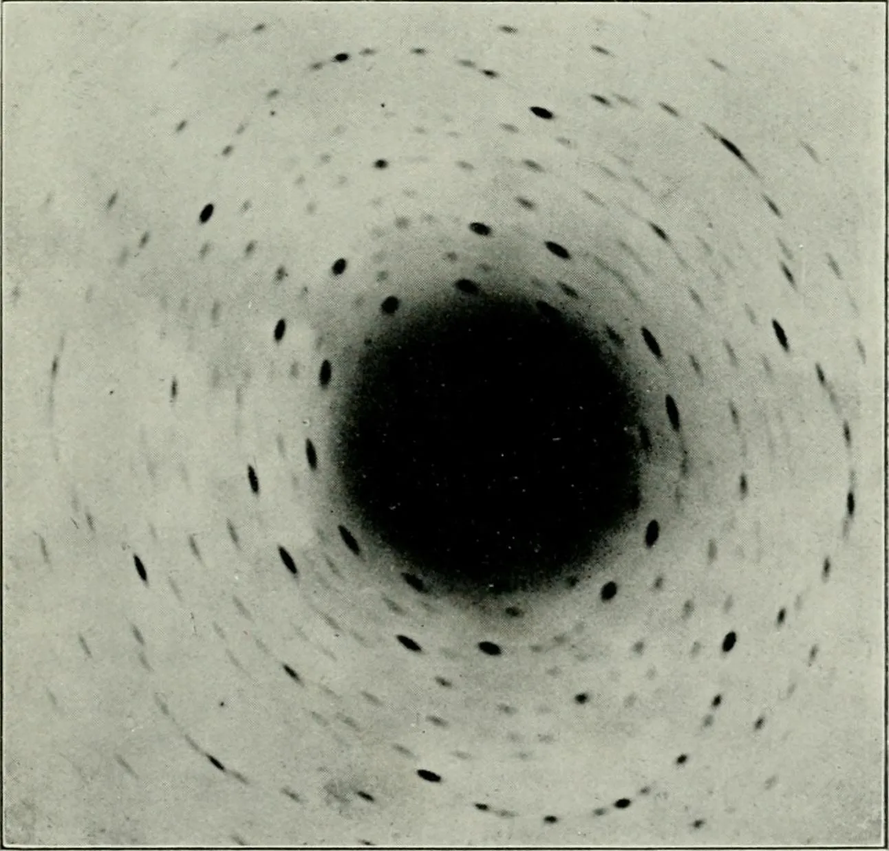
:::

:::l1 {notes=off size=caption}
Munich[^ph-laueapp]: von Laue sees a regular pattern of spots → X-rays are waves, a crystal is a grating[^ph-laue]
:::

:::laueapp {notes=off fit}
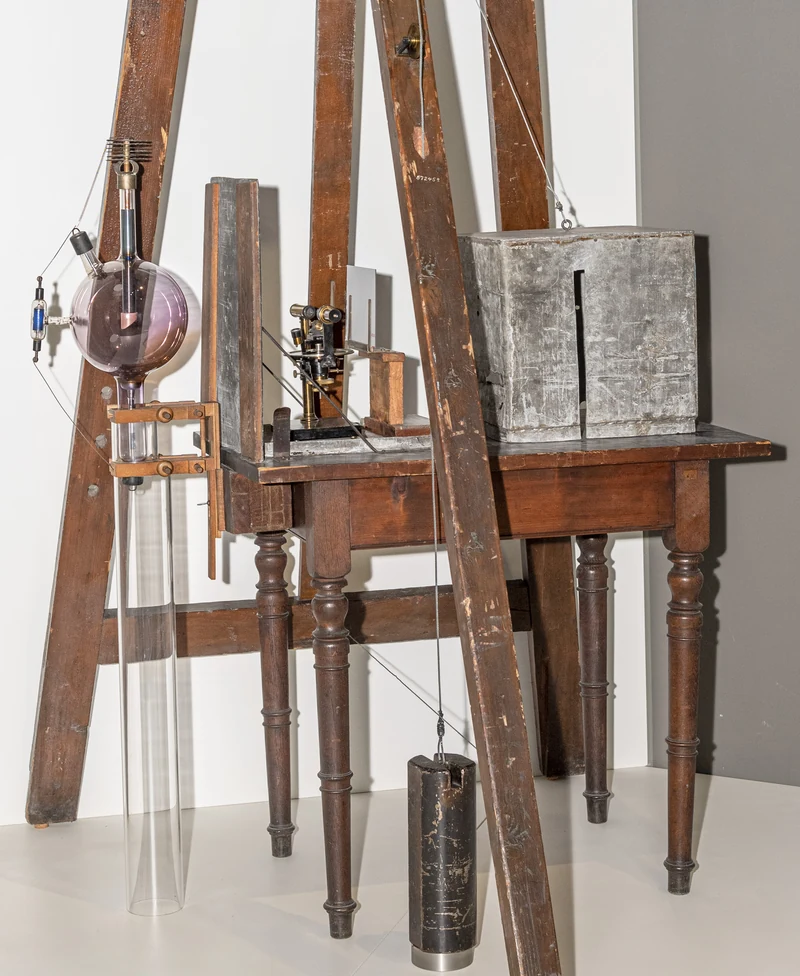
:::

:::step

:::p3 {notes=off size=40% fit}
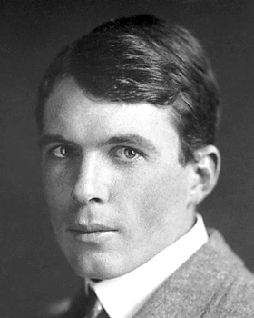

[**William Lawrence Bragg**]{size=205%} [1890–1971]{size=205%}
:::

:::h3 {notes=off size=110%}
**1912, Cambridge: the son interprets**
:::

:::schematic {notes=off fit}
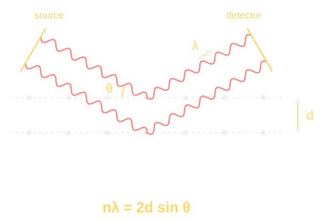
:::

:::l3 {notes=off size=125%}
- reflections from **planes of atoms**
- in phase when $n\lambda = 2d\sin\theta$
- **path difference, phase, interference**
:::

:::step

:::p2 {notes=off size=40% fit}
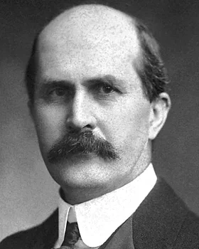

[**William Henry Bragg**]{size=205%} [1862–1942]{size=205%}
:::

:::h2 {notes=off size=110%}
**1913, Leeds: the father measures**
:::

:::spectro {notes=off fit}
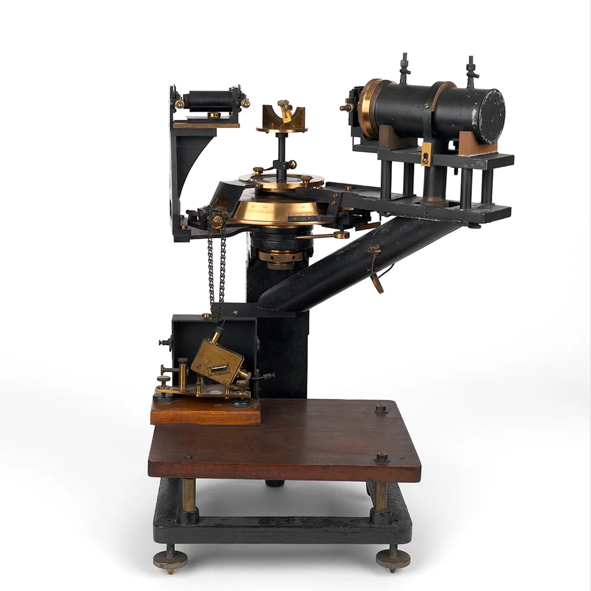
:::

:::measure {notes=off fit}
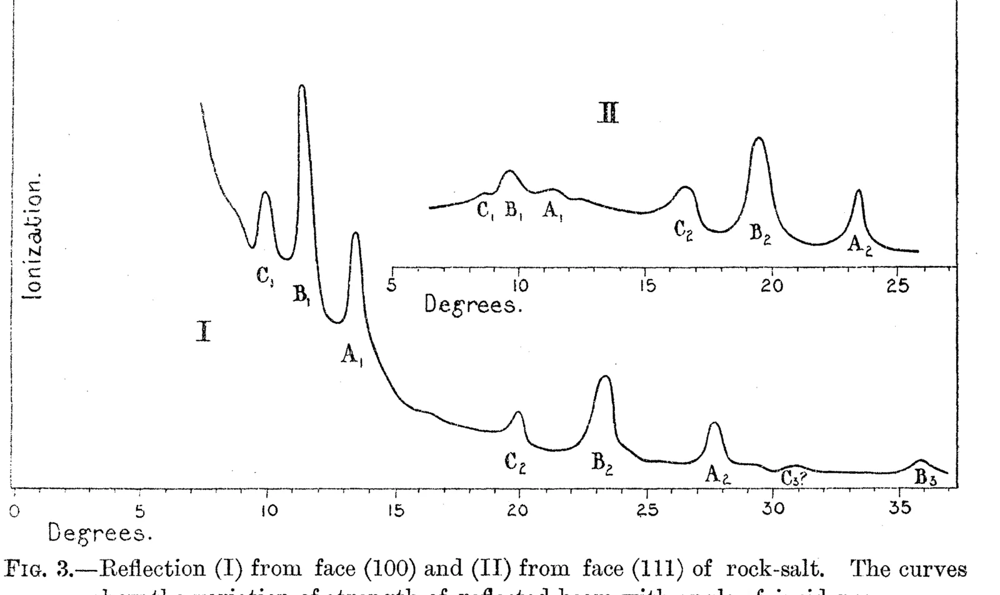
:::

:::c2 {notes=off size=caption}
ionisation spectrometer[^ph-rigb] and measurement[^bragg1913]
:::

:::step

:::nobel {notes=off size=110%}
**1914 & 1915 Nobel Prizes:** making the invisible visible — a crystal lattice read from its echoes — the talk's first **inverse problem**
:::

:::m1 {notes=off fit}
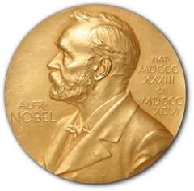
:::

:::m2 {notes=off fit}

:::

:::m3 {notes=off fit}

:::

[^bragg1913]: W. H. Bragg and W. L. Bragg, "The reflection of X-rays by crystals," *Proc. R. Soc. Lond. A*, vol. 88, no. 605, pp. 428–438, 1913.

:::notes
- (65 s, off by 02:35)
- lead-in: 1912, Munich: von Laue sent X-rays through a crystal and got these spots: X-rays are waves, and the crystal is a grating.
- (click) The son, Lawrence Bragg, still a student in Cambridge, explained the spots the same year: reflections from planes of atoms, and they add up when the path difference is a whole number of wavelengths.
- (click) The father, William Henry Bragg, measured them in Leeds with this spectrometer: for us, a swept, narrow-band receiver.
- (click) [optional] Reading a lattice from its echoes is the first inverse problem in this talk.
- The son was twenty-five when he heard of his Nobel Prize, at the front.
- bridge: And that brings us to the war.
:::

# 1914–1918: Europe Thrown into Chaos From Flanders to the Somme: remembrance — and an engineering problem {#flanders}

:::place
poppies: 0.0357 0.1670 0.4900 0.6133
bleuet: 0.0007 0.1048 0.0700 0.1244
ranging: 0.5356 0.1670 0.4288 0.6133
text: 0.0357 0.7750 0.9286 0.1200
:::

:::poppies {notes=off fit}
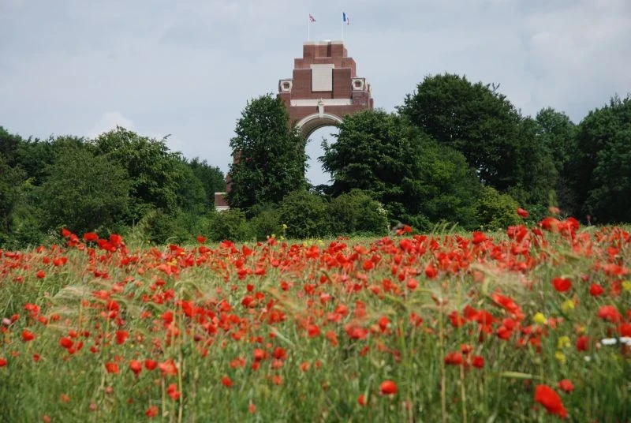
:::

:::bleuet {notes=off fit}

:::

:::ranging {notes=off fit}
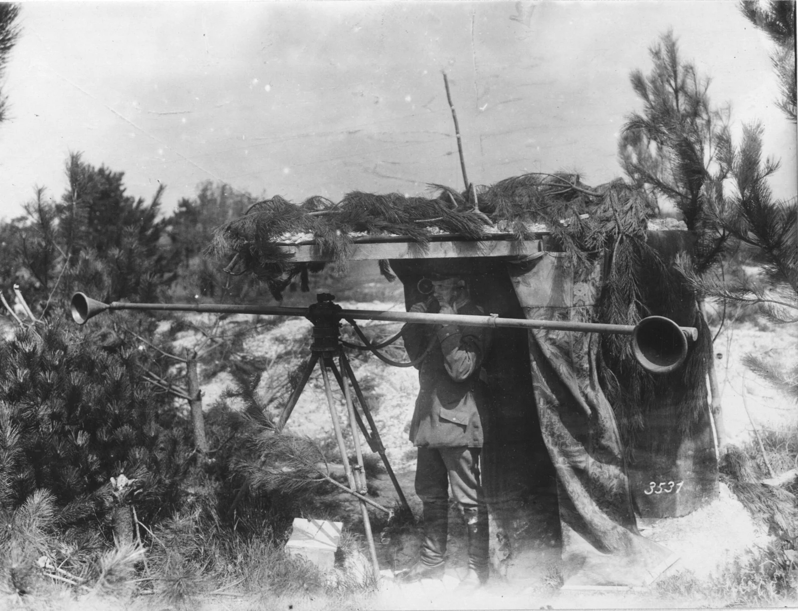
:::

:::text {notes=off size=130%}
**Two legacies of the same war**: remembering the loss and those who served, so that we can live free and at peace in Europe — and a spark of ideas that are still evolving
:::

:::notes
- (40 s, off by 03:15)
- lead-in (calmly): Last Wednesday was the 108th anniversary of the Armistice.
- In 1914 Europe was thrown into chaos. History doesn't repeat itself, but it often rhymes, and its echoes still reach us today.
- Let us remember all who served and all who died, on every side.
- (do: pause, two seconds)
- These poppies are at Thiepval, on the Somme. Bragg's first sound-ranging section worked near Ypres, from late 1915.
- bridge: For the engineers, that war also posed a very concrete problem.
:::

# A New Type of War: Shelled from out of Sight … Where Is That Gun? sound ranging works on a quiet range and fails at the front {#problem}

:::place
text: 0.0357 0.1250 0.5300 0.1800
text2: 0.0357 0.2550 0.5300 0.2200
moerser: 0.1481 0.4666 0.3250 0.4689
station: 0.6188 0.0579 0.3562 0.5420
circled: 0.6188 0.0579 0.3562 0.5420
clip: 0.6188 0.5800 0.3562 0.2600
clipcap: 0.6188 0.8420 0.3562 0.0600
:::

:::text {notes=off}
- **devastating**: artillery causes most of the casualties — soldiers no longer face each other; they are shelled from kilometres away by guns they never see
- the eye fails (night, fog, hidden flashes), the ear and a stopwatch are too coarse
:::

:::moerser {notes=off size=caption fit}
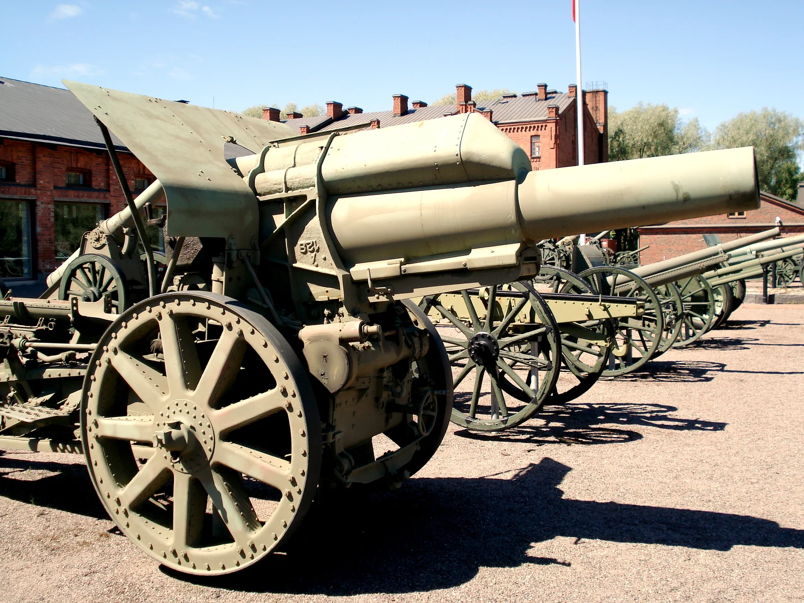

German 21 cm Mörser: 11 km range, fired from behind a hill[^ph-moerser]
:::

:::step

:::text2 {notes=off}
- **the French idea**, 1914: Nordmann and Bull — microphones on a surveyed base, measure the **delays** between them[^costley]
- on a quiet range near Paris: a gun to 40 m; at the front the carbon microphones hear the shell's **supersonic crack**, the bursts, rifles and machine guns — not the gun
:::

:::station {notes=off fit}
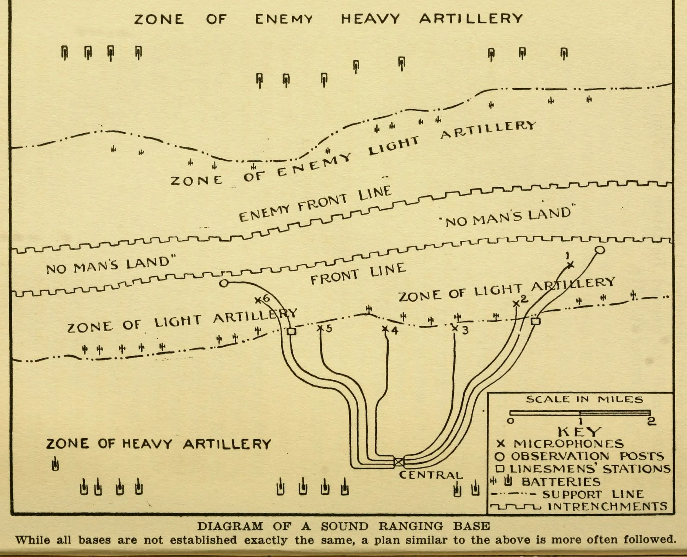
:::

:::clip {notes=off fit}
:::video
src: media/armistice-coda-to-coda.webm
audio: true
autoplay: false
loop: false
:::
:::

:::clipcap {notes=off size=caption}
a sound-ranging base, after J. R. Hinman, 1919[^ph-hinman]; sound ranging film, IWM Q 47886, 11:00, 11 November 1918[^iwmq47886] — P for the sonification by Coda to Coda[^coda]
:::

:::step {in=fade}

:::circled {notes=off fit}
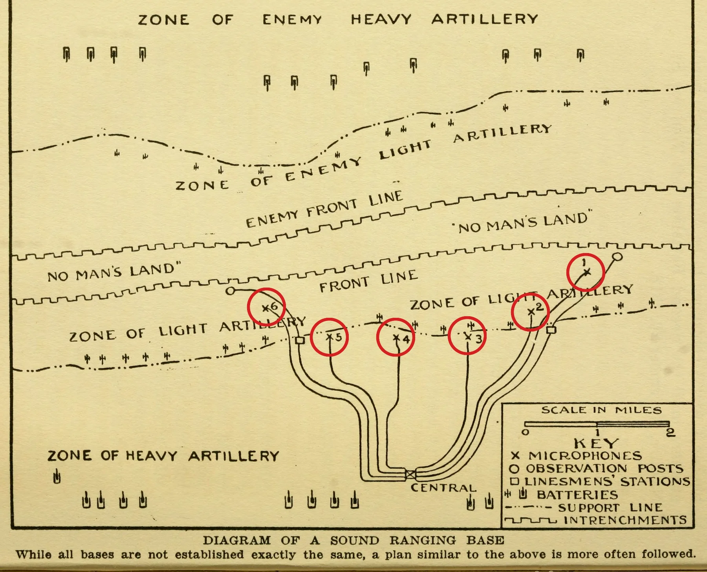
:::

[^costley]: R. D. Costley Jr., "Battlefield acoustics in the First World War: artillery location," *Acoustics Today*, vol. 16, no. 2, pp. 31–39, 2020, doi: 10.1121/AT.2020.16.2.31.
[^iwmq47886]: Imperial War Museums, sound-ranging film record of the artillery activity on the American front near the River Moselle, one minute before and after the Armistice, 11 Nov. 1918, American Embassy Collection, catalogue no. Q 47886, IWM Non Commercial Licence. [Online]. Available: https://www.iwm.org.uk/collections/item/object/205281906
[^coda]: Coda to Coda, "IWM – WW1 Armistice Interpretation (Sound Installation)," 1 min, released 6 Nov. 2018, all rights reserved. [Online]. Available: https://codatocoda.bandcamp.com/album/iwm-ww1-armistice-interpretation-sound-installation

:::notes
- (70 s, off by 04:25)
- lead-in: It was a new type of war: most casualties came from artillery, fired from kilometres away by guns nobody saw.
- At night or in fog the eye doesn't help, and an ear with a stopwatch is far too coarse. You need milliseconds.
- (click) In November 1914 two Frenchmen, Nordmann and Bull, put microphones on a surveyed base and timed the delays. On a quiet range near Paris they placed a gun to forty metres.
- At the front, it failed. Every shot makes three sounds: the shell's supersonic crack, the burst, and the gun. Add wind and rifles.
- (click) The bases that worked used six microphones on a seven-kilometre arc. Here is the record from the morning of the Armistice, as a modern sonification: guns, then silence.
- (do: play only the last seconds of the clip, not the full minute)
- bridge: So let's try it ourselves: a drum, four microphones, and you.
:::

# Experiment 1: a Drum, Four Microphones — and Shakers Nordmann and Bull's sound-ranging experiment, and why it failed at the front {#exp1}

:::place
live: 0.0357 0.1250 0.9286 0.7250
toolbar: 0.3500 0.8550 0.6143 0.0900
card0: 0.0250 0.5200 0.3325 0.4800
photo: 0.0357 0.5280 0.3150 0.4300
photocap: 0.1306 0.9420 0.2000 0.0400
card1: 0.0250 0.5200 0.3325 0.4800
group: 0.0357 0.5280 0.3150 0.4450
:::

:::gr4
id: exp1
region: live
workflow: workflows/exp1-claps.grc
lifecycle: run-while-visible
toolbar: toolbar
:::

:::card0 {notes=off fit layer=above}

:::

:::photo {notes=off fit layer=above}
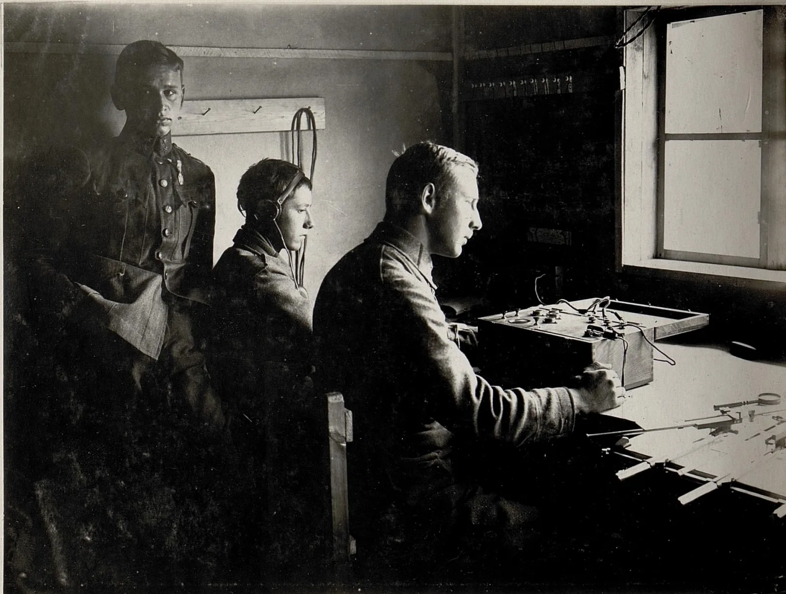
:::

:::photocap {notes=off size=caption layer=above}
1917: a sound-ranging headquarter[^ph-sr]
:::

:::step

:::card1 {notes=off fit layer=above}

:::

:::group {notes=off size=caption fit layer=above}
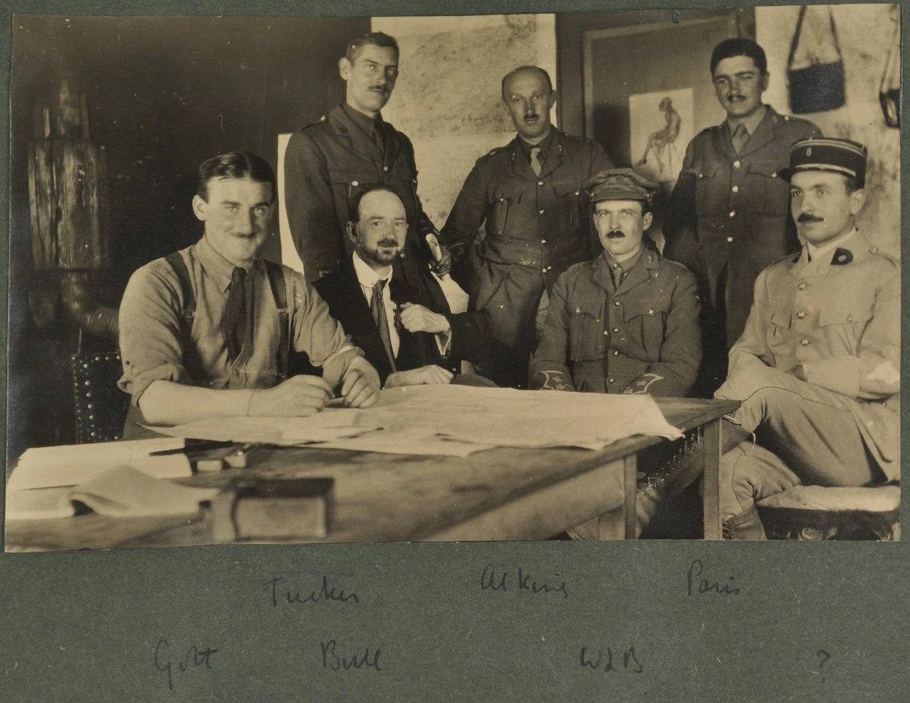

Tucker, Bull, Bragg, Paris and colleagues, c. 1916[^ph-srgroup]
:::

:::notes
- (130 s, off by 06:35)
- before the talk: `devtools/four-mics-browser-pairs.sh setup`; `input` on the microphones, simulation as the fallback; first clap straight in front of mic 2, `align: once`
- lead-in: Here is a sound-ranging base in miniature: four microphones, one metre apart.
- (do: hit the drum)
- Each microphone hears it a little later than the one before. Sound travels about thirty-four centimetres per millisecond.
- Each delay puts the drum on a hyperbola, and where the hyperbolas cross, there is the drum.
- Now, could I ask a few of you to shake these? (do: hand out the shakers)
- Now the trigger fires on the hiss. That was the front in 1916.
- (click) And these are the sound rangers at one table: Bull seated, Bragg in the peaked cap, Tucker standing on the left. By 1917 they placed a gun to about twenty-five metres.
- Keep the hyperbolas in mind; they come back.
- bridge: So how did they hear the gun, and not the crack?
:::

# Experiment 2: 1916 — Tucker's Microphone then: a hot wire in an ammunition box (Helmholtz resonator); today: a digital band-/low-pass {#lowpass}

:::place
live: 0.0357 0.1250 0.9286 0.7250
toolbar: 0.3500 0.8550 0.6143 0.0900
card: 0.0250 0.5200 0.3325 0.3600
mic: 0.0357 0.5280 0.3150 0.3300
miccap: 0.0357 0.8650 0.3150 0.0700
popup: 0.2500 0.1300 0.4500 0.7700
:::

:::gr4
id: lowpass
region: live
workflow: workflows/exp1b-lowpass.grc
lifecycle: run-while-visible
toolbar: toolbar
:::

:::card {notes=off fit layer=above}

:::

:::mic {notes=off fit layer=above}
:::

:::miccap {notes=off size=caption}
Tucker's hot wire, 1916[^ph-tuckermic] — the gun's slow puff cools it, the shell's crack does not — a band-pass in brass[^iwm]
:::

:::step {in=grow}

:::popup {notes=off fit layer=above}
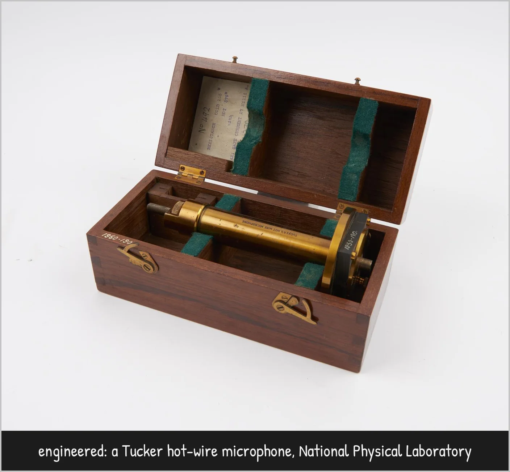
:::

[^iwm]: Imperial War Museums, "Sound Ranging Explained." [Online]. Available: https://www.iwm.org.uk/history/first-world-war/western-front/sound-ranging-explained

:::notes
- (80 s, off by 07:55)
- lead-in: Tucker, in his hut, noticed a puff of cold air at each heavy gun, but not at the crack.
- His microphone was a hot wire across the hole of an ammunition box. For us, a Helmholtz resonator: a band-pass at ten to twenty-five hertz.
- Let me do the same in software. (do: drag the band's upper edge down)
- The hiss goes away, and we find the drum again.
- There is a price, though: the narrower the band, the slower the edges, and the less precise the timing.
- (click) And this is the engineered version, in brass.
- bridge: So far we timed sound to the millisecond. After the war, the question was how to time a push to a particle.
:::

# One Big Push, or Many Small Timed Ones? — RF "accelerates" Particles Lord Rutherford wanted faster projectiles — two routes, 1924–1932 {#widero master=people}

:::place
h1: 0.0357 0.1250 0.4625 0.0450
ising: 0.0357 0.1700 0.2169 0.2789
bild1: 0.2575 0.1700 0.2375 0.2789
cap1: 0.0357 0.4450 0.4625 0.0350
cyclo: 0.0357 0.4850 0.2031 0.3244
t1: 0.2500 0.4850 0.2482 0.3000
h2: 0.5125 0.1250 0.3306 0.0450
cascade: 0.5125 0.1700 0.2063 0.5022
t2: 0.5125 0.6750 0.3306 0.1800
waltonline: 0.0357 0.8700 0.8072 0.0500
people: 0.8607 0.0190 0.1143 0.8667
tag: 0.2750 0.7420 0.1940 0.0400
:::

:::tag {notes=off fit}

:::

:::h1 {notes=off size=110%}
**many small pushes, in phase — radio**
:::

:::ising {notes=off fit}
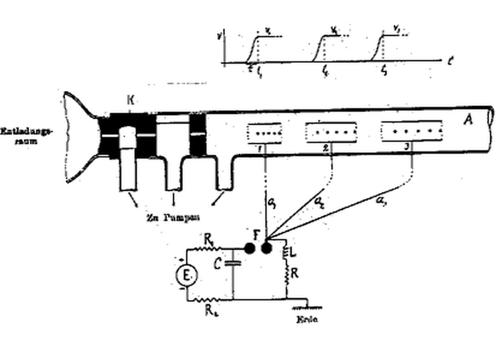
:::

:::bild1 {notes=off fit}
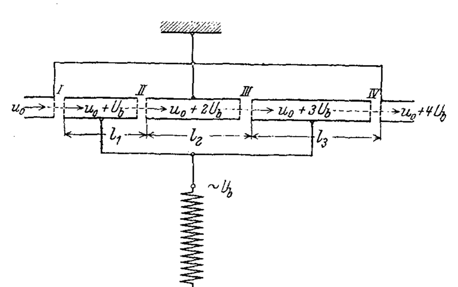
:::

:::cap1 {notes=off size=caption}
Ising's proposal, 1924 · Widerøe's principle, 1928[^ph-wideroe]
:::

:::cyclo {notes=off size=caption fit}
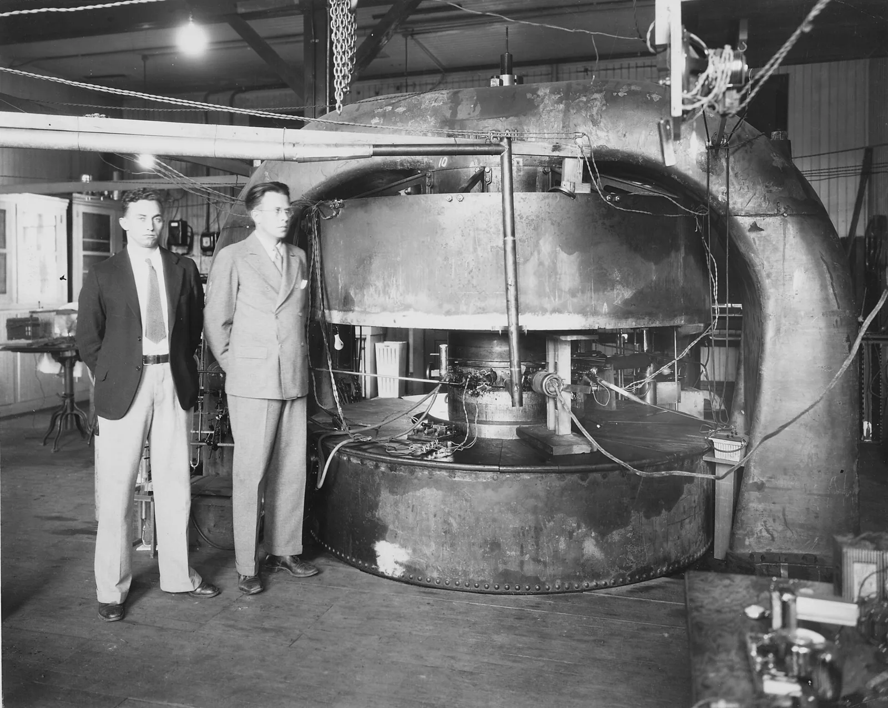

Livingston and Lawrence, the 27-inch cyclotron[^ph-cyclotron]
:::

:::t1 {notes=off}
- 1924 Ising proposes, 1928 Widerøe builds: **RF hands energy to ions**, in phase with their flight[^waloschek]
- 1929 Lawrence reads the diagrams; 1931: **the cyclotron**
- the route to the energy frontier
:::

:::h2 {notes=off size=110%}
**one big push — static**
:::

:::cascade {notes=off size=caption fit}
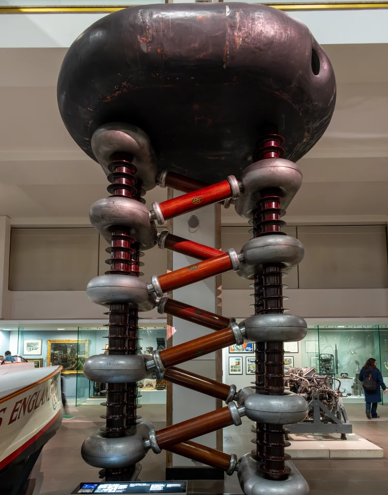

a Cockcroft–Walton cascade, Cavendish
:::

:::t2 {notes=off}
- 14 April 1932, Cockcroft and Walton: **p + Li → 2α** — the first disintegration by artificially accelerated particles, from ~125 kV[^betatron]
- first to the milestone; RF went further — static machines live on as injectors
:::

:::waltonline {notes=off}
Walton had tried Widerøe's route first — the ray-transformer on his own, the drift tube after reading him: both failed.
:::

:::people {notes=off size=40% fit}
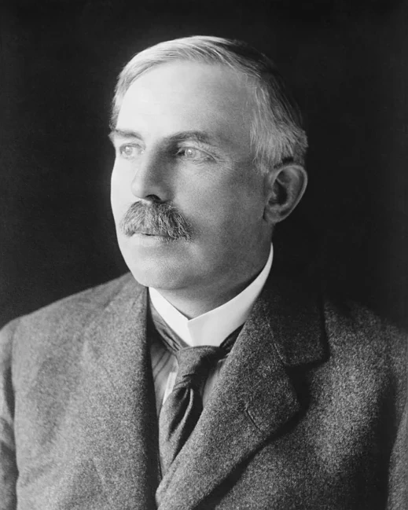

[**Ernest Rutherford**]{size=205%} [1871–1937]{size=205%}

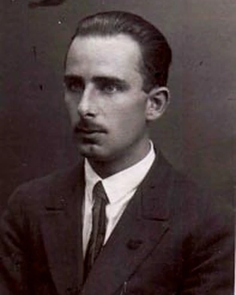

[**Rolf Widerøe**]{size=205%} [1902–1996]{size=205%}

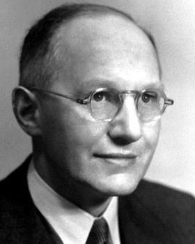

[**Ernest Walton**]{size=205%} [1903–1995]{size=205%}
:::

[^waloschek]: P. Waloschek, *The Infancy of Particle Accelerators: Life and Work of Rolf Wideröe*. Braunschweig: Vieweg, 1994. [Online]. Available: https://www-library.desy.de/elbook.html

:::notes
- (60 s, off by 08:55)
- lead-in: Rutherford wanted faster projectiles, to break up nuclei.
- There were two ways to get there: one big push, or many small pushes, each timed by a radio wave.
- Ising proposed the small pushes in 1924, and Widerøe built them in 1928. Lawrence read his diagrams and built the cyclotron in 1931: an idea carried over, and documented.
- The big push came first: Cockcroft and Walton split lithium in 1932. But in the long run, RF went much further.
- bridge: Widerøe had another idea too, and it failed twice.
:::

# The Betatron Widerøe Could Have Built an idea from 1922 — lost to isolation and a bare glass wall, made to work by Kerst in 1940 {#betatron}

:::place
fig: 0.0357 0.1250 0.4800 0.3722
text: 0.0357 0.5100 0.4800 0.4000
photo: 0.5500 0.1250 0.3294 0.7300
tag: 0.2200 0.7110 0.2770 0.0400
:::

:::tag {notes=off fit}

:::

:::fig {notes=off size=caption fit}
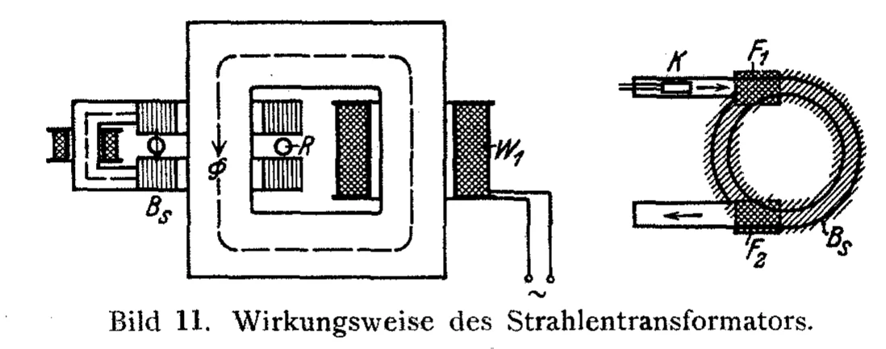

Widerøe's ray-transformer, 1928 (Bild 11)[^ph-wideroe]
:::

:::text {notes=off}
- **1922**, a student's notebook: the ray-transformer, its 2:1 rule — an old idea[^waloschek]
- **1926–27**, Aachen: ~1½ turns — charge on the **bare glass wall**, no focusing yet; Rogowski (his PhD advisor): no doctorate "for something that did not function" — he builds the linac instead
- alone, then war: Walton (1928) and Steenbeck (1935) fail or stay secret; [**NOBODY COMPARES NOTES**]{colour=#ffcc00}
- **1940**, Kerst: added a thin, grounded **silver film** inside the glass & a focusing field — voilà: 2.3 MeV, the **betatron**[^betatron]
- 1941: one *Physical Review* reaches occupied Norway — "like a thunderbolt"; the word stays: **betatron oscillations**, the tune
:::

:::photo {notes=off size=caption fit}
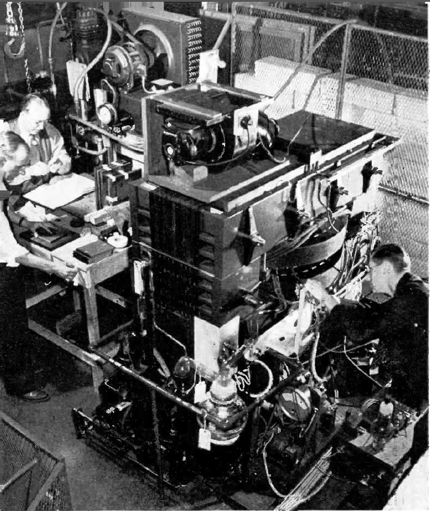

1942 betatron, Illinois (Electronics, 1942)
:::

[^betatron]: J. D. Cockcroft and E. T. S. Walton, "Disintegration of lithium by swift protons," *Nature*, vol. 129, p. 649, 1932; E. T. S. Walton, "The production of high speed electrons by indirect means," *Proc. Camb. Phil. Soc.*, vol. 25, pp. 469–481, 1929; D. W. Kerst, "The acceleration of electrons by magnetic induction," *Phys. Rev.*, vol. 60, pp. 47–53, 1941; D. W. Kerst and R. Serber, "Electronic orbits in the induction accelerator," *Phys. Rev.*, vol. 60, pp. 53–58, 1941.

:::notes
- (80 s, off by 10:15)
- lead-in: In 1922, a student's notebook already contained the betatron: Widerøe's ray-transformer.
- In Aachen it made about one and a half turns: the electrons charged up the bare glass wall, and his professor refused him a doctorate for it.
- Walton tried it in 1928 and failed; Steenbeck built one in 1935 and kept it secret. Nobody compared notes, so it was found again and again, independently.
- In 1940 Kerst added a thin silver film and a focusing field, and it worked. When his paper reached occupied Norway, it hit Widerøe like a thunderbolt.
- [optional] One word from this stayed with us: the beam wobbles around its orbit at its own frequency, the betatron oscillation, and we call that frequency the tune.
- Personally, I think one exchange in the late 1920s would have given us these machines ten years earlier.
- bridge: Back to radio, where again two routes led to one goal.
:::

# Transmit the Direction, or Measure the Delays? two routes to the same goal — on approach today, both {#navigation}

:::place
h1: 0.0357 0.1250 0.4543 0.0450
lorenz: 0.0357 0.1700 0.4100 0.2400
lz: 0.0357 0.3950 0.4543 0.0420
ye: 0.0357 0.4550 0.2900 0.2300
sectors: 0.3400 0.4450 0.1500 0.2600
yecap: 0.0357 0.6800 0.4543 0.0800
ils: 0.0357 0.7650 0.2300 0.1500
today: 0.2800 0.7600 0.2250 0.1700
h2: 0.5100 0.0250 0.4543 0.0450
loran: 0.5100 0.0700 0.4543 0.4800
lorcap: 0.6300 0.5300 0.3300 0.0700
quote: 0.5100 0.6100 0.4543 0.1000
t3: 0.5100 0.7500 0.3400 0.1000
wrline: 0.5100 0.8750 0.2700 0.0500
wrlogo: 0.7850 0.8550 0.0600 0.0850
tag: 0.5100 0.6850 0.2040 0.0380
:::

:::h1 {notes=off size=110%}
**transmit the direction**
:::

:::lorenz {notes=off fit}
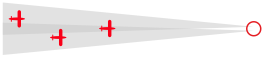
:::

:::lz {notes=off}
Lorenz 1932: fly the equisignal[^ph-lorenz]
:::

:::step

:::ye {notes=off fit}
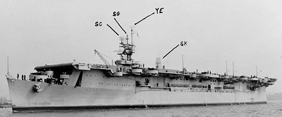
:::

:::sectors {notes=off fit}
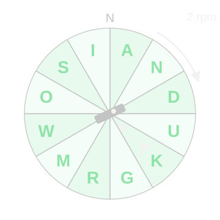
:::

:::yecap {notes=off}
YE–ZB "Hayrake", NRL 1937: a Morse letter per 30° sector — home to a moving airfield[^nav]
:::

:::step

:::ils {notes=off fit}
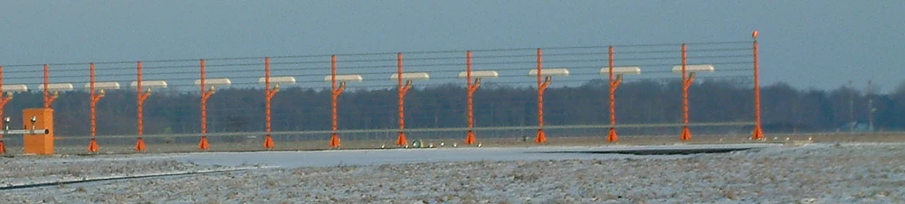
:::

:::today {notes=off size=90%}
today: **ILS**, VOR
:::

:::step

:::h2 {notes=off size=110%}
**measure the delays**
:::

:::loran {notes=off fit}
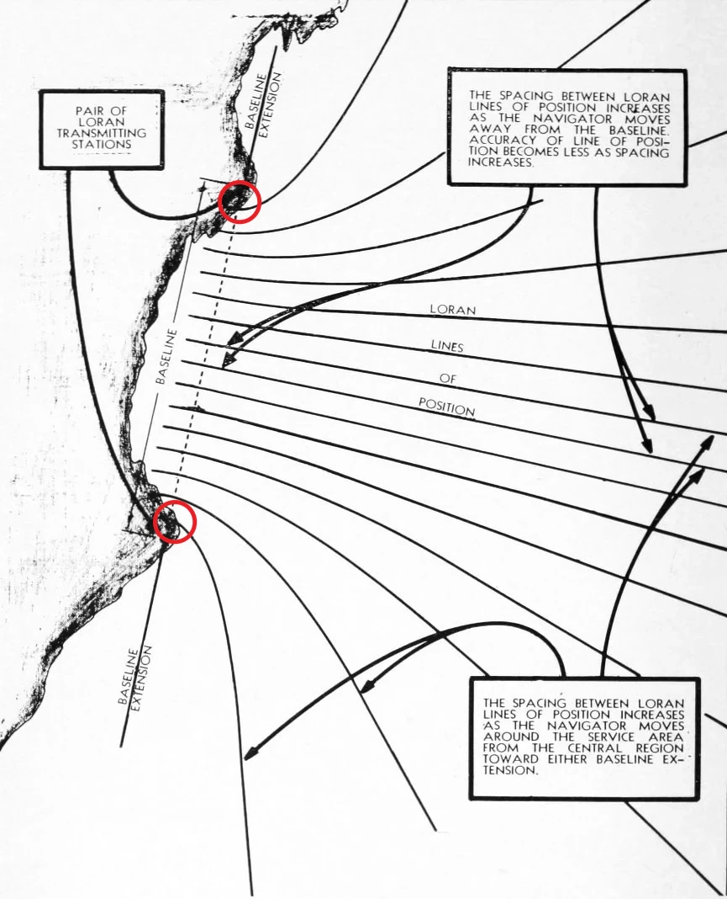
:::

:::lorcap {notes=off}
Gee 1942–43, LORAN (Rad Lab) Decca, OMEGA: the same but phase
:::

:::tag {notes=off fit}

:::

:::quote {notes=off}
"similar in principle … with reversal of the direction of travel of the signals" — the Rad Lab's *Loran* volume, 1948, on WWI sound ranging[^nav]
:::

:::t3 {notes=off size=90%}
today: **GNSS**, multilateration
:::

:::wrline {notes=off size=90%}
down the line: precision time-keeping → **White Rabbit**
:::

:::wrlogo {notes=off fit}
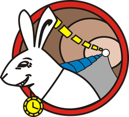
:::

[^nav]: Smithsonian National Air and Space Museum, "Time and Navigation." [Online]. Available: https://timeandnavigation.si.edu/; J. A. Pierce, A. A. McKenzie and R. H. Woodward, Eds., *Loran*, MIT Radiation Laboratory Series, vol. 4. New York: McGraw-Hill, 1948, §1-4, p. 10; L. A. Gebhard, *Evolution of Naval Radio-Electronics and Contributions of the Naval Research Laboratory*, NRL Report 8300, 1979, pp. 272–274.

:::notes
- (80 s, off by 11:35)
- lead-in: How do you guide an aircraft: do you transmit the direction, or do you measure delays?
- In 1932, Lorenz: you fly along the equisignal, where dots and dashes merge into one steady tone.
- (click) [optional] In 1937, Hayrake: one Morse letter per sector, so a pilot could home in on a moving carrier.
- (click) Today, that is the ILS on every runway.
- (click) Gee and LORAN, 1942 and 43, measured delays instead. Each delay is a hyperbola: experiment one in reverse. The Rad Lab said so itself: the same maths as sound ranging, run backwards.
- And radar? You send the pulse yourself and time its echo. Several countries found that independently in the mid-1930s, and we will do it at the end of this part.
- And down the line, precise timing became White Rabbit, which came out of CERN and which we use at GSI.
- An airliner on approach today uses both routes.
- bridge: Decca did the same with phase instead of delays. Let's see what that buys you, and what it costs.
:::

# Experiment 3: Detection by Phase no edge to time, one line to find{#exp2}

:::place
live: 0.0357 0.1250 0.9286 0.7250
toolbar: 0.3500 0.8550 0.6143 0.0900
card: 0.0250 0.5200 0.3325 0.3600
decca: 0.0357 0.5280 0.3150 0.4300
:::

:::gr4
id: exp2
region: live
workflow: workflows/exp2-noise-tone.grc
lifecycle: run-while-visible
toolbar: toolbar
:::

:::card {notes=off fit layer=above}

:::

:::decca {notes=off size=caption fit layer=above}
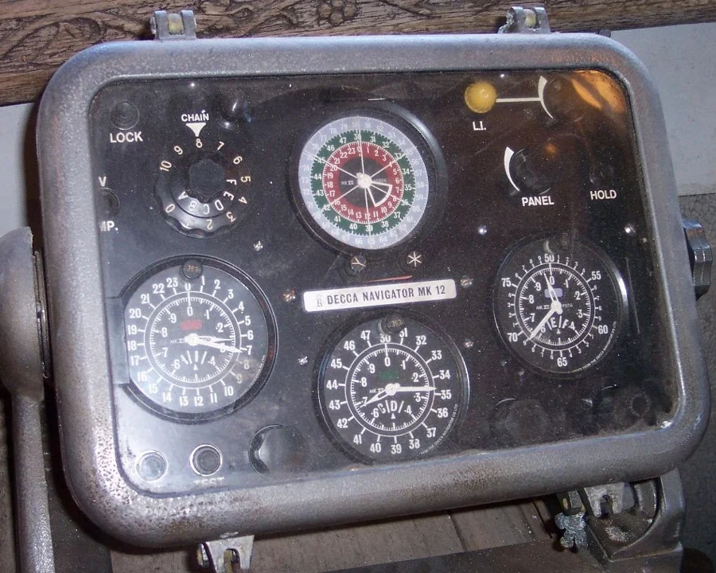

Decca, from 1944: its dials count the lanes the phase cannot[^ph-decca]
:::

[^ph-decca]: Decca Navigator Mk 12, photo: Stahlkocher, CC BY-SA 3.0, via Wikimedia Commons.

:::notes
- (80 s, off by 12:55)
- `input`: simulation at 160 Hz, or the microphones; `tone` → 440 Hz, the fork
- lead-in: A click contains every frequency; a tone contains just one.
- (do: strike the fork) One line in the waterfall.
- The four traces are shifted sine waves. But which crest belongs to which?
- The correlation peaks repeat one period apart, and at 440 hertz they turn into ghosts. The phase tells you where you are within a period, but not which period.
- Decca's dials counted the lanes the phase couldn't. A PLL calls it a cycle slip. Two names, one problem.
- bridge: Back to the beams: a beam that guides your aircraft can also be heard by the other side.
:::

# A Different "Battle of the Beams" electronic warfare grows up — intercept, jam, spoof {#beams master=people}

:::place
map: 0.0357 0.1300 0.4000 0.5110
ov0: 0.0357 0.1300 0.4000 0.5110
ov1: 0.0357 0.1300 0.4000 0.5110
ov2: 0.0357 0.1300 0.4000 0.5110
ov3: 0.0357 0.1300 0.4000 0.5110
mapcap: 0.0357 0.6500 0.4000 0.0400
clock0: 0.4500 0.1300 0.3950 0.5450
clock1: 0.4500 0.1300 0.3950 0.5450
clock2: 0.4500 0.1300 0.3950 0.5450
clock3: 0.4500 0.1300 0.3950 0.5450
close: 0.0357 0.7400 0.8000 0.0800
p1: 0.8607 0.0190 0.1143 0.2950
bbc: 0.8607 0.3350 0.1143 0.2322
ally: 0.8607 0.5700 0.1143 0.2722
allycap: 0.8607 0.8420 0.1143 0.0600
:::

:::map {notes=off fit}
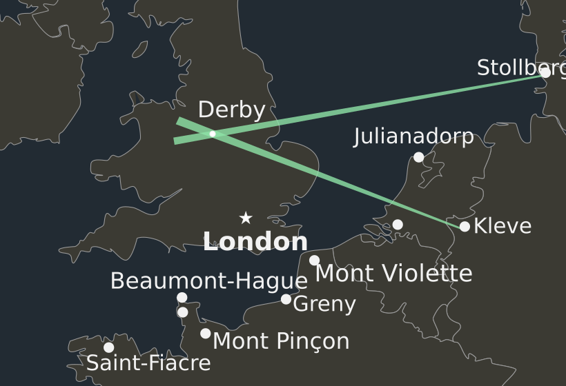
:::

:::ov0 {notes=off fit}
:::

:::mapcap {notes=off size=caption}
Knickebein, 1940: two beams cross over Derby
:::

:::clock0 {notes=off fit}
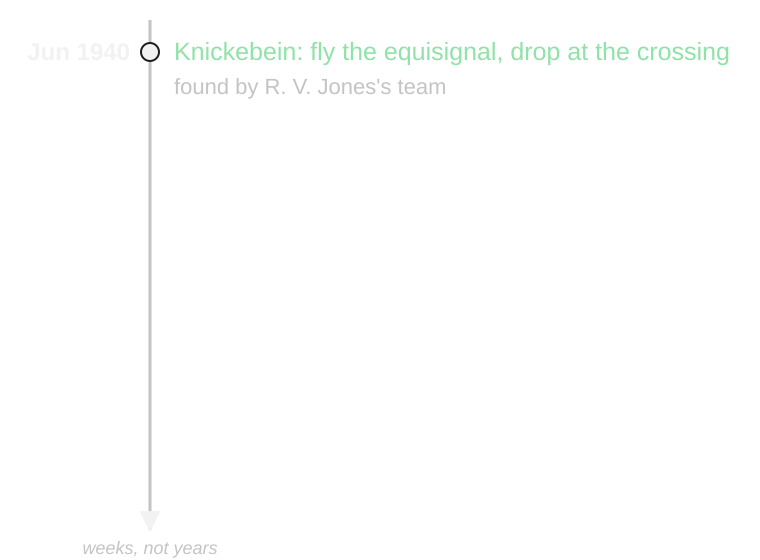
:::

:::p1 {notes=off size=40% fit}
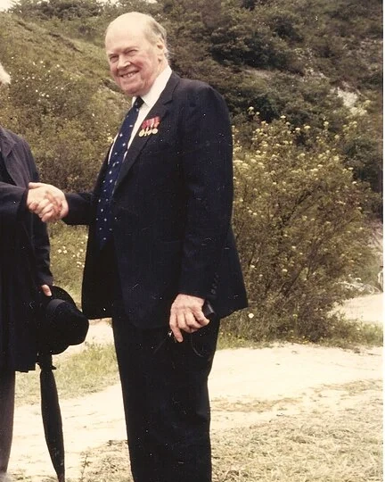

[**Reginald V. Jones**]{size=205%} [1911–1997]{size=205%}
:::

:::ov1 {notes=off fit}
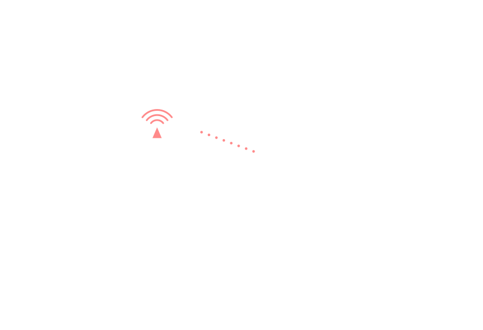
:::

:::clock1 {notes=off fit}
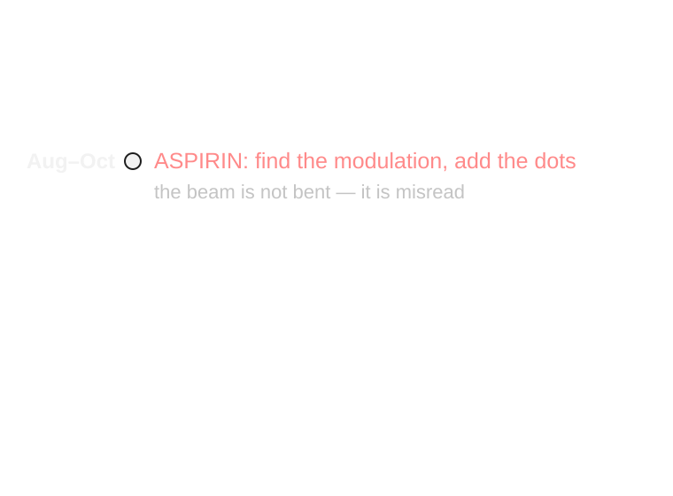
:::

:::step

:::ov2 {notes=off fit}
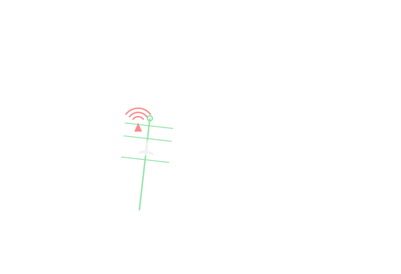
:::

:::clock2 {notes=off fit}
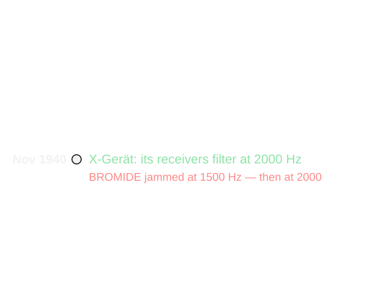
:::

:::step

:::ov3 {notes=off fit}
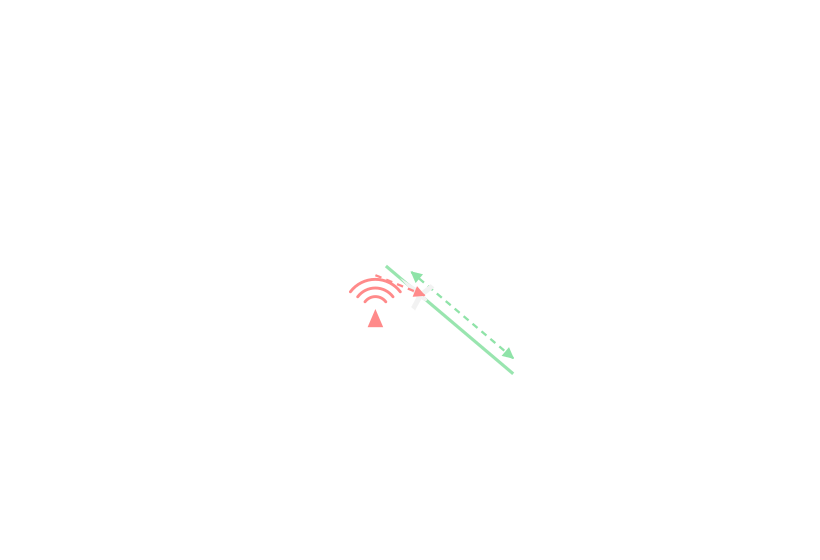
:::

:::clock3 {notes=off fit}
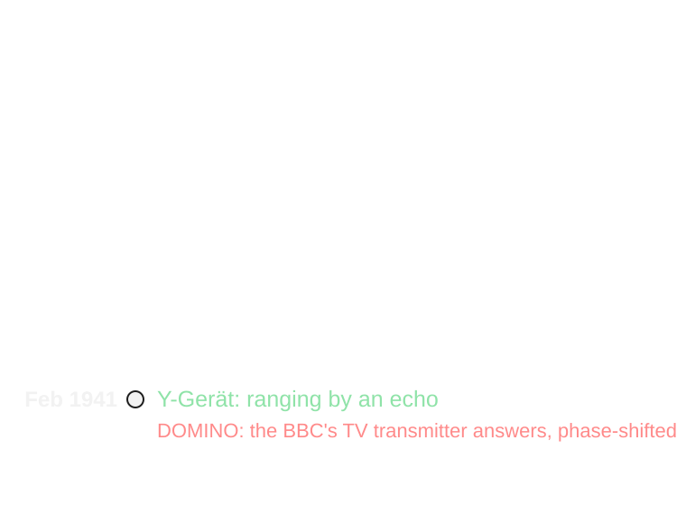
:::

:::bbc {notes=off fit}
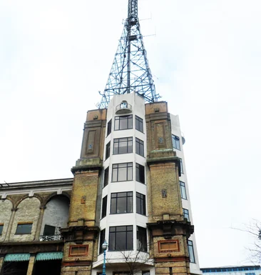
:::

:::ally {notes=off fit}
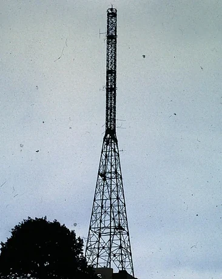
:::

:::allycap {notes=off size=caption}
DOMINO's transmitter: Alexandra Palace[^ph-allybbc][^ph-ally]
:::

:::close {notes=off}
radio navigation, **not radar** — the first fully fought electronic war[^jones]
:::

[^jones]: R. V. Jones, *Most Secret War: British Scientific Intelligence 1939–1945*. London: Hamish Hamilton, 1978.

:::notes
- (90 s, off by 14:25)
- lead-in: Three moves, a few months apart. German guidance is in green, the British counter in red.
- June 1940, Knickebein: two beams from Kleve and Stollberg crossed over the target. R. V. Jones found them, and ASPIRIN keyed its own Morse into the beam. The beam wasn't bent; the pilots misread it.
- (click) November, X-Gerät: its receivers filtered at 2000 hertz, and the first BROMIDE jammers sent 1500. The receiver's filter decided, which is experiment two again.
- (click) February 1941, Y-Gerät ranged by an echo. DOMINO answered from the BBC's TV transmitter at Alexandra Palace and re-radiated the ranging signal with a phase shift. Broadcasting turned into electronic warfare.
- This was radio navigation, not radar, and it was the first fully fought electronic war.
- sources: Jones (1978), pp. 127–129, 151, 164, 175–177; Price (1977), pp. 44–49
- bridge: And if you listen long enough, you hear signals nobody meant to send.
:::

# Signals You Didn't Mean to Send communications → radar → SIGINT → TEMPEST → passive diagnostics {#unintended}

:::place
ladder: 0.0357 0.1250 0.4500 0.8000
spikes: 0.5150 0.0200 0.4493 0.2700
mixer: 0.6209 0.2900 0.2000 0.3720
scope: 0.8284 0.2900 0.1263 0.3720
cap43: 0.6209 0.6410 0.3339 0.0450
kuhn: 0.6209 0.7000 0.1506 0.2170
cap85: 0.6209 0.9080 0.2300 0.0600
:::

:::ladder {notes=off fit}

:::

:::step

:::mixer {notes=off fit}

:::

:::scope {notes=off fit}

:::

:::cap43 {notes=off size=caption}
1943: Bell Labs' 131-B2 cipher mixer — and an oscilloscope across the lab[^tempest]
:::

:::spikes {notes=off fit}

:::

:::step

:::kuhn {notes=off fit}

:::

:::cap85 {notes=off size=caption}
1985: van Eck reads a screen with a TV set — 2003: Kuhn, through three walls[^kuhn]
:::

[^tempest]: National Security Agency, "TEMPEST: A Signal Problem," *Cryptologic Spectrum*, 1972 (declassified 2007). [Online]. Available: https://www.nsa.gov/portals/75/documents/news-features/declassified-documents/cryptologic-spectrum/tempest.pdf; photos: War Department, TM 11-2209 (1946), Fig. 1, public domain; DuMont 208-B, Harvard Putnam Gallery, Daderot, CC0, Wikimedia Commons.
[^kuhn]: W. van Eck, "Electromagnetic radiation from video display units: An eavesdropping risk?" *Computers & Security*, vol. 4, no. 4, pp. 269–286, 1985; M. G. Kuhn, "Compromising emanations: eavesdropping risks of computer displays," Univ. of Cambridge, Tech. Rep. UCAM-CL-TR-577, 2003, Fig. 4.3 (not cleared, talk only).

:::notes
- (50 s, off by 15:15)
- lead-in: Look at this ladder: at every step the emitter means less of what it sends, but the maths stays the same.
- (click) 1943: a Bell Labs engineer saw spikes on an oscilloscope across the lab, and read a cipher machine's plain text from them.
- (click) 1985: van Eck read a computer screen with a TV set. In 2003, Kuhn read one through three walls.
- bridge: So a system's signals tell you more about its state than the system reports.
:::

# {#gremlin master=title-logo}

:::layout
background: wavepackets
:::

:::place
eye: 0.3559 0.1900 0.2906 0.2667
name: 0.1875 0.5706 0.6250 0.1419
link: 0.1897 0.7233 0.6000 0.1200
:::

:::eye {notes=off fit}

:::

:::name {notes=off fit}

:::

:::link {notes=off size=150%}
[[https://fair-acc.github.io/gremlin/](https://fair-acc.github.io/gremlin/)]{colour=#ffff00} [[https://www.irisproject.eu/](https://www.irisproject.eu/)]{colour=#ffff00}
:::

:::notes
- (20 s, off by 15:35)
- lead-in: That is GREMLIN: one sensor on the mains feed tells you which devices run, drift or fail.
- The details are in my next talk, at 15:10.
- bridge: Listening to noise is older than GREMLIN: accelerators have lived on it for fifty years.
:::

# Schottky: Somebody's Noise is Somebody Else's Signal Hear Particle Beams without touching — then act on it: Antiprotons, the W and Z — and single Ions today {#schottky master=people}

:::place
s1: 0.0357 0.1250 0.5000 0.2650
t1: 0.5550 0.1350 0.2800 0.2400
isr: 0.0357 0.4000 0.2300 0.4600
cool: 0.2750 0.4000 0.2700 0.4600
esr: 0.5400 0.3300 0.3100 0.5600
people: 0.8607 0.0190 0.1143 0.8667
medal: 0.9577 0.5954 0.0350 0.0622
:::

:::s1 {notes=off fit}

:::

:::t1 {notes=off}
**1918**: shot noise *is* information[^schottky] — a ring's noise tells its momentum spread and tune: **hear the beam without touching it**
:::

:::people {notes=off size=40% fit}

[**Walter Schottky**]{size=205%} [1886–1976]{size=205%}

[**Simon van der Meer**]{size=205%} [1925–2011]{size=205%}
:::

:::isr {notes=off size=caption fit}

**hear** — the ISR, 1972: the first Schottky scans[^borer]
:::

:::step

:::cool {notes=off size=caption fit}

**act** — van der Meer: dense antiprotons, the W and Z[^vdm]
:::

:::medal {notes=off fit}

:::

:::step

:::esr {notes=off fit}

:::

[^schottky]: W. Schottky, "Über spontane Stromschwankungen in verschiedenen Elektrizitätsleitern," *Ann. Phys.*, vol. 362, no. 23, pp. 541–567, 1918.
[^borer]: J. Borer, P. Bramham, H. G. Hereward, K. Hübner, W. Schnell and L. Thorndahl, "Non-destructive diagnostics of coasting beams with Schottky noise," in *Proc. 9th Int. Conf. High Energy Accelerators*, Stanford, CA, USA, 1974, pp. 53–56; the 1972 scans: CERN Annual Report 1972, p. 109, as reproduced in P. J. Bryant, "The impact of the ISR on accelerator physics and technology," CERN, 2012, arXiv:1206.3950, Fig. 16, CC BY 3.0.
[^vdm]: S. van der Meer, "Stochastic damping of betatron oscillations in the ISR," CERN, Geneva, Switzerland, Rep. CERN/ISR-PO/72-31, 1972.

:::notes
- (75 s, off by 16:50)
- lead-in: One of my favourite sayings from instrumentation: somebody's noise is somebody else's signal.
- In 1918 Schottky explained shot noise.
- In a ring, each particle passes the pick-up once per turn, so each one gives a line, and all of them together a comb. The width of each band tells you the momentum spread.
- In 1972 the ISR made the first Schottky scans: hearing the beam without touching it.
- (click) Then van der Meer acted on that noise with feedback. Stochastic cooling gave dense antiprotons, then the W and the Z, and a Nobel Prize in 1984.
- (click) And today, in GSI's storage ring, the decay of one single ion is one line that ends.
- bridge: That was many particles. Inside a single bunch, things get fast.
:::

# Same Answer, Twice: Split the Band Before the ADC radio does it in software, the MIM in copper — found independently {#mim}

:::place
ht0: 0.0357 0.1350 0.1888 0.3600
ht1: 0.2320 0.1350 0.1888 0.3600
htcap: 0.0357 0.4950 0.3851 0.0750
ear: 0.0357 0.5800 0.3600 0.3850
fig: 0.4375 0.0553 0.5268 0.4930
proto: 0.5060 0.5409 0.2240 0.2854
pcb: 0.7400 0.5409 0.2240 0.2854
tag: 0.5200 0.8350 0.2770 0.0400
:::

:::tag {notes=off fit}

:::

:::ht0 {notes=off fit}

:::

:::ht1 {notes=off fit}

:::

:::htcap {notes=off}
ex. PS Booster, 1974[^mim]: head-tail betatron motion inside one particle bunch. LHC: 1 kV carrier, 1 ns long, "AM/FM"-modulated @ $\scriptstyle 10^{-6}$!
:::

:::ear {notes=off size=caption fit}

the ear splits the band first; the cochlear radio copies it[^cochlea]
:::

:::fig {notes=off fit}

:::

:::proto {notes=off size=caption fit}

2012 prototype: SPS, LHC
:::

:::pcb {notes=off size=caption fit}

2013 16-band prototype[^mim]
:::

[^mim]: R. J. Steinhagen, M. J. Boland, and T. G. Lucas, "A Multiband-Instability-Monitor for high-frequency intra-bunch beam diagnostics," *Proc. IBIC2013*, Oxford, paper and talk TUBL3, CC BY 3.0; CERN-ACC-2013-0294; the head-tail traces: J. Gareyte, "Head-tail type instabilities in the PS and Booster," CERN, 1974.
[^cochlea]: S. Mandal et al., *IEEE J. Solid-State Circuits* 44(6), 2009; D. F. Albuquerque et al., *Proc. IEEE IMWS*, 2010; OFDM: R. W. Chang, *Bell Syst. Tech. J.* 45(10), 1966; S. B. Weinstein and P. M. Ebert, *IEEE Trans. Commun. Technol.* 19(5), 1971.

:::notes
- (55 s, off by 17:45)
- lead-in: Inside one particle bunch, right now, the beam moves head against tail.
- A one-nanosecond bunch needs six to twelve gigahertz, and no ADC that fast has enough bits.
- So you split the band before the ADC. Radio does the same after the ADC, in software, and calls it OFDM; the ear does it first, in the cochlea.
- We found the same answer independently, in copper. (understated) This was our MIM development at CERN.
- [optional] On the LHC that's a one-kilovolt carrier, modulated at a part per million.
- bridge: The last experiment sends its own signal.
:::

# Experiment 4: Finding a Signal Below the Noise known chirp in the noise — trick behind LoRa, GPS and long-range radar {#exp6}

:::place
live: 0.0357 0.1250 0.9286 0.7250
toolbar: 0.3500 0.8550 0.6143 0.0900
card: 0.0250 0.5200 0.3325 0.3600
pc: 0.0357 0.5280 0.3150 0.3300
pccap: 0.0357 0.8650 0.3150 0.0700
:::

:::gr4
id: exp6
region: live
workflow: workflows/exp6-chirps.grc
lifecycle: run-while-visible
toolbar: toolbar
:::

:::card {notes=off fit layer=above}

:::

:::pc {notes=off fit layer=above}

:::

:::pccap {notes=off size=caption}
radar's answer: a long pulse with the resolution of a short one — pulse compression, built on the matched filter (North 1943)[^north]
:::

[^north]: D. O. North, "An analysis of the factors which determine signal/noise discrimination in pulsed-carrier systems," RCA Laboratories, Rep. PTR-6C, June 1943; reprinted in *Proc. IEEE*, vol. 51, no. 7, pp. 1016–1027, 1963.

:::notes
- (110 s, off by 19:35)
- lead-in: Send a known pulse, find it again, and the delay gives you the range. That is radar, and sonar.
- (default, `input` recorded; say so) This is a recording from the rehearsal. The chirp sinks into the noise, but the matched filter's peak stays.
- (or `input` on the microphones, only before 18:30) Now the speaker pings. The first peak is the direct path, every later one is an echo. (do: move a board 1–2 m behind mic 1) Its peak moves about six milliseconds per metre, while the room's clutter stays put.
- The gain is the time-bandwidth product: twenty milliseconds times seven kilohertz, about a hundred and forty, or twenty-one dB.
- It's one receiver with many names: radar, sonar, GPS, which arrives twenty dB below the noise, Wi-Fi, and the swept excitation in accelerators.
- If asked: chirp radars came after North's filter (Klauder et al., 1960).
- bridge: So how did all this cross between fields? One tube shows it.
:::

# The Klystron Goes to War and Comes Home an accelerator's cavity turned RF source — radar gave back receivers and pulsers, the accelerators tubes, timing and detectors {#loop}

:::place
fig: 0.0357 0.1250 0.4800 0.7000
credits: 0.0357 0.8300 0.4800 0.0900
trades: 0.5300 0.1250 0.4343 0.7300
tcap: 0.5300 0.8550 0.4343 0.0650
tag: 0.5600 0.8000 0.1940 0.0400
:::

:::tag {notes=off fit}

:::

:::fig {notes=off fit}

:::

:::credits {notes=off size=85%}
the klystron's loop: Stanford's linacs[^slac7731], [^slac2mile]; Berkeley's surplus SCR-268s[^slac3221] · photos[^ph-loop]
:::

:::step

:::trades {notes=off fit}
![what radar and the accelerators traded besides the klystron's loop: radar to accelerators — the superhet receiver in BPM and LLRF electronics (C), monopulse Σ/Δ to the 1981 BPM processors, Rad Lab pulsers to SLAC's modulators, the wartime magnetron to the S-band and medical linacs, surplus SCR-268s to the Alvarez linac, radar's spectrum analyser to the ISR's Schottky noise (C), radar receiver boards to the Tevatron BPMs; and back, in gold — Hansen's accelerator cavity to the radar oscillator (1938), Oliphant's cyclotron lab to the cavity magnetron (1940), Lawrence's cyclotroneers to the Rad Lab, linac klystrons to the BMEWS and Goldstone radars (1959), collider trackers to the Fermi gamma-ray telescope (2008), CERN pixel chips to the ISS radiation monitors (2012), White Rabbit timing to the EISCAT_3D radar (2022)](figures/radar-trades.svg)
:::

:::tcap {notes=off size=125%}
same problem — different domains[^trades], [^back]
:::

[^slac7731]: G. Caryotakis, "The Klystron: A Microwave Source of Surprising Range and Endurance," SLAC-PUB-7731, 1998. [Online]. Available: https://www.slac.stanford.edu/pubs/slacpubs/7500/slac-pub-7731.pdf
[^slac3221]: SLAC-PUB-3221, "Elementary Principles of Linear Accelerators," 1983. [Online]. Available: https://www.slac.stanford.edu/pubs/slacpubs/3000/slac-pub-3221.pdf
[^slac2mile]: R. B. Neal (ed.), *The Stanford Two-Mile Accelerator*, ch. 1–3. New York: Benjamin, 1968. [Online]. Available: https://ahro.slac.stanford.edu/sites/default/files/2024-08/Chapters_1_3.pdf
[^back]: G. Caryotakis, SLAC-PUB-7731, 1998 (the cavity, the Mark III klystrons in BMEWS); A. E. Siegman, "Edward L. Ginzton," NAS Biographical Memoirs; W. B. Atwood et al., "The Large Area Telescope on the Fermi Gamma-ray Space Telescope," *Astrophys. J.*, vol. 697, p. 1071, 2009; L. Pinsky et al., Timepix-based radiation environment monitors on the ISS, *J. Radiat. Res.*, vol. 55, 2014; EISCAT_3D synchronisation tender, 2022 (White Rabbit, CERN WR switch v3).
[^ph-loop]: Photos, via Wikimedia Commons, public domain: "Prototype klystron cutaway," *Electronics*, vol. 13, 1940; Flt Lt Goodchild, RAF, "WAAF radar operator Denise Miley, Bawdsey, May 1945," IWM CH 15332; US Army Signal Corps, "Radar" (an SCR-268), Casablanca, 1943, NARA 531325; US Office of Naval Research, "Mark III linear electron accelerator," Stanford, early 1950s; US Department of Energy, "SLAC klystron gallery," c. 1968.
[^trades]: R. E. Shafer, "Beam position monitoring," *AIP Conf. Proc.*, vol. 249, p. 601, 1992; S. P. Jachim, R. C. Webber and R. E. Shafer, "An RF beam position measurement module for the Fermilab energy doubler," *IEEE Trans. Nucl. Sci.*, vol. NS-28, p. 2323, 1981; R. B. Neal (ed.), *The Stanford Two-Mile Accelerator*, 1968, modulator chapter, ref. 1: G. N. Glasoe and J. V. Lebacqz, *Pulse Generators*, MIT Radiation Laboratory Series, vol. 5, 1948; C. W. Miller, "An 8-MeV linear accelerator for X-ray therapy," *Proc. IEE*, vol. 101, 1954; M. Chodorow et al., *Proc. IRE*, vol. 47, p. 20, 1959; J. Borer et al., HEACC 1974; the Tevatron BPM upgrade, *JINST* 6 T11005, 2011.

:::notes
- (60 s, off by 20:35)
- lead-in: At Stanford, Hansen built a resonant cavity for an accelerator, and the Varian brothers turned it into the klystron: an amplifier tube where electrons bunch up in one cavity and give their energy to the next.
- The klystron was carried over twice: into radar, then home to the linacs, which soon wanted more power than radar had ever asked for.
- [optional] In the centre: war-surplus SCR-268 radars set the 200 megahertz of Alvarez's linac at Berkeley. If asked: through their power supplies, not their oscillators.
- (click) Radar and accelerators traded much more than that; let me read just three rows.
- bridge: The tube crossed because people carried it.
:::

# The People Cross the Boundaries knowledge moved because people moved — and many of the moves were driven by war {#people}

:::place
l0: 0.0100 0.1050 0.9800 0.8850
l1: 0.0100 0.1050 0.9800 0.8850
:::

:::l0 {notes=off fit}

:::

:::step

:::l1 {notes=off fit}
![twenty-three more lines over the same lanes, almost all bending in a war — Hertz and Rutherford from radio; the sonar people Boyle, A. B. Wood, Fessenden, G. W. Pierce, Barkhausen; Jansky's radio astronomy; W. H. Bragg to anti-submarine acoustics; the French connection — Nordmann and Esclangon from the Paris Observatory to sound ranging and back, Langevin's ultrasonic sonar, Rocard from radio to radar to radio astronomy; Tuve, Bowen, Lovell, Oliphant, McMillan, Cockcroft, Touschek, Blumlein, Reeves, Kompfner](figures/people-lines-1.svg)
:::

:::notes
- (45 s, off by 21:20)
- lead-in: Knowledge moved because people moved.
- Lawrence Bragg went from X-rays to sound ranging and back to crystals. Randall went from phosphors to the cavity magnetron, and later to DNA by X-rays at King's College. Hansen, the Varians and Alvarez went from accelerators to radar and back.
- Nearly every line bends inside a war: the war moved people, it didn't invent for them.
- (click) Here are twenty-three more. (do: let it stand for a few seconds, no names)
- bridge: And when you draw all these crossings together, you get the next picture.
:::

# Not a Tree — a Braid 140 years, three kinds of crossing: transfer, co-evolution, parallel invention — most arrows are people {#braid}

:::place
base: 0.0100 0.1050 0.9800 0.8150
line: 0.0357 0.9250 0.8000 0.0500
:::

:::base {notes=off fit}

:::

:::line {notes=off size=125%}
**The waves have not changed. What changed is where we put the intelligence.**
:::

:::notes
- (45 s, off by 22:05)
- lead-in: It's not a tree, it's a braid.
- Three kinds of crossing, the ones you have seen along the way: solid where an idea was carried over and it's documented, dashed where it was found twice, independently, dotted where it's just the same maths. The dotted ones we must not over-claim.
- The instruments strand turns gold, and gold is software: today's four experiments ran as GNU Radio 4 blocks in this browser.
- bridge (the bottom line, slowly): The waves have not changed. What changed is where we put the intelligence.
:::

# Echoes from the Past into the Future … …learn from it twice {#learn master=title-logo}

:::place
head: 0.0357 0.0400 0.6400 0.0900
sub: 0.0357 0.1400 0.6400 0.0700
pop: 0.0357 0.2850 0.4400 0.3900
lep: 0.5050 0.2850 0.4400 0.3900
bleuet: 0.0357 0.6680 0.0420 0.0750
c1: 0.0820 0.6700 0.4400 0.3000
c2: 0.5050 0.6700 0.4400 0.3000
c3: 0.5050 0.8200 0.4400 0.0700
ask: 0.0357 0.8650 0.7800 0.0550
contact: 0.0357 0.9300 0.7800 0.0450
:::

:::layout
logo: media/gnuradiodays-2026-banner-cutout.webp
:::

:::contact {notes=off}
[Ralph J. Steinhagen · GSI/FAIR, Darmstadt, Germany · [https://github.com/fair-acc/gnuradio4](https://github.com/fair-acc/gnuradio4)]{colour=#ffff00}
:::

:::pop {notes=off fit}

:::

:::lep {notes=off fit}

:::

:::bleuet {notes=off fit}

:::

:::c1 {notes=off size=150%}
**as citizens** — remember, keep the memory alive, — so that it never happens again
:::

:::c2 {notes=off size=150%}
**as engineers and scientists** — shared language, shared tools, the fundamentals taught: so that good ideas cross before we reinvent them
:::

:::c3 {notes=off size=150%}
— and understand why an idea failed in the past — with today's tools, it may echo to the present and deserve a second look
:::

:::ask {notes=off size=160%}
[**Questions? Let's talk — what do you call this in your field?**]{colour=#ffff00}
:::

:::notes
- (55 s, off by 23:00)
- lead-in: So what do we learn from these echoes? I think we learn twice.
- As citizens: remember, and keep the memory alive, so that it never happens again.
- As engineers and scientists: share the language and the tools, and teach the fundamentals, so that good ideas cross before we reinvent them.
- And understand why an idea failed. Widerøe's betatron failed on a bare glass wall; with today's tools, an old idea may deserve a second look.
- bridge (last words): So, my question to you: what do you call this in your field?
- (alternative ending, instead of the question, not in addition: "Everybody makes mistakes … the wise learn from the mistakes of others. So let's share our experience, our ideas, our aspirations, and our wisdom.")
:::

# References {#references master=blank}

:::place
list: 0.0200 0.0950 0.9600 0.8800
:::

:::list {size=80%}
:::references 1-22
qr: https://github.com/fair-acc/gnuradio4
label: GNU Radio 4
:::
:::

:::notes
- every work the deck cites, numbered as on its slides, in two parts (`:::references 1-22`, then `23-`), right after the close; the backups follow; portraits: sources in media/portraits/PORTRAITS.md; picture credits in media/CREDITS.md
:::

# References cont'd {#references2 master=blank}

:::place
list: 0.0200 0.0950 0.9600 0.8800
:::

:::list {size=80%}
:::references 23-
qr: https://github.com/fair-acc/gnuradio4
label: GNU Radio 4
:::
:::

:::notes
- the second half of the references, with the same QR codes; the links of the citation marks lead to whichever of the two slides lists the number
:::

# Backup — The Braid, 2026 the instruments strand turned gold — wire, brass, film and valves became blocks in a flow graph {#strands2026}

:::place
fig: 0.0357 0.1300 0.9286 0.7500
:::

:::fig {notes=off fit}

:::

:::notes
- the instruments strand turns gold from the 1960s: the FFT (1965), the software radio (1990s), GNU Radio (2001), GNU Radio 4.0
- backup since round 52 (the main line ends on `braid`): no arrows on the slide, and no list — only the colour, cyan to gold
- the strands do not merge: physics, radio and radar stay separate fields; what they increasingly share is the instruments strand — and that we can maintain together, in the open
- also on this stretch: van Eck (1985), White Rabbit (2008), the cochlear radio and the MIM (2009–13)
- also on the accelerators strand now: the ISR (1971, Schottky's noise heard from a beam), the Sp̄pS (1981), LEP (1989), the LHC (2008), FAIR — and the FCC, perhaps (;-)
- next: the whole braid in detail
- 30 s
:::

# Backup — The Echoes Remain the same instruments, re-labelled in today's language {#echoes master=double}

:::layout
grid: [(text)]
:::

:::text {notes=off size=90%}
| the first time | the rhyme, today |
| --- | --- |
| 1887 Hertz: spark gap, resonant loop | an SDR: generate, detect, characterise |
| 1917 sound ranging: film, hot wire | four microphones, ADC, band-pass, TDOA |
| 1918 Schottky: noise is information | spectral estimation, single ions |
| 1924–40 Ising, Widerøe, Kerst: RF in phase | LLRF holds the phase; the tune |
| 1932–43 Lorenz beam; Gee, LORAN | ILS, VOR; GNSS |
| 1940 Knickebein: the receiver's filter | jam the receiver, not the beam |
| 1937–50 klystron: Stanford → radar | klystron linacs, superhet BPMs |
| 1943 North: the matched filter | pulse compression, GNSS, Wi-Fi |
| 1943 Bell Labs: a cipher mixer's spikes | TEMPEST → GREMLIN |
| 1966 OFDM, 2009 cochlear radio | 2013 MIM: sixteen bands in copper |
:::

:::right {notes=off}

**History doesn't repeat, but it often rhymes.**
:::

:::notes
- read two or three rows, not all: the drum and the band-pass heard tonight are 1917 in software; one row runs backwards — radio had OFDM and the cochlear radio first, the MIM found the same answer in copper in 2013
- the quotation, unattributed on purpose: the earliest known form is Theodor Reik, 1965 ("… it merely rhymes"); "said Mark Twain" first appears in 1970 (J. R. Colombo), sixty years after his death; Twain and Warner only wrote "History never repeats itself" (*The Gilded Age*, 1874) — Quote Investigator, 2014
- claim discipline as on `braid`: transfer, co-evolution, parallel invention per row — most transfers are a person moving (`people`); the parallel rows share the maths, not a lineage: say "rhymes", never "descends from"
- background, not said — rows to slides (T transfer, C co-evolution, P parallel): Hertz `hertz`/`chain` T · sound ranging `problem`/`exp1`/`lowpass` P (Bragg's X-ray phase → acoustics T) · Schottky `schottky` T · Ising/Widerøe/Kerst `widero`/`betatron` T · navigation `navigation` C · Knickebein `beams` T · klystron `loop`/`people` T (superhet BPMs C) · North `exp6` P · Bell Labs `unintended`/`gremlin` P · MIM `mim` C (advisor, round 56)
:::

# Backup — One Problem, Many Disguises basic science → a real problem → engineering → better instruments {#chain}

:::place
chain: 0.0357 0.1150 0.9286 0.2690
questions: 0.0357 0.3900 0.9286 0.2550
braid: 0.0357 0.6550 0.9286 0.3360
:::

:::chain {notes=off fit}

:::

:::questions {notes=off striped size=90%}
| 1887 Hertz | 1900s radio | 1912 the Braggs | 1915 Bragg, Tucker | 1920s RF acceleration | 1930s navigation | 1935 radar | 1940 SIGINT | 1970s beam diagnostics | today LLRF, feedback |
| :---: | :---: | :---: | :---: | :---: | :---: | :---: | :---: | :---: | :---: |
| *does the wave exist?* | *what did you say?* | *where are the atoms?* | *where is that gun?* | *when do I push?* | *where am I?* | *where are you?* | *what are you doing?* | *what is the beam doing?* | *can I hold it there?* |
:::

:::braid {notes=off fit}

:::

# Backup — Pulses or Spectra? two ways of seeing the same signal — and for a century engineers have reasoned in both {#duality master=people}

:::place
fig: 0.0357 0.1250 0.8000 0.4770
braid: 0.0357 0.6350 0.8000 0.3360
people: 0.8607 0.0190 0.1143 0.8667
:::

:::fig {notes=off fit}

:::

:::braid {notes=off fit}

:::

:::people {notes=off size=40% fit}

[**Carl Friedrich Gauss**]{size=205%} [1777–1855]{size=205%}

[**Joseph Fourier**]{size=205%} [1768–1830]{size=205%}

[**Cooley, Tukey**]{size=205%} [the FFT, 1965]{size=205%}
:::

# Backup — The Braid So Far: to 1950 radio, radar and accelerators trade parts and people — the instruments are still valves {#strands1950}

:::place
fig: 0.0357 0.1300 0.9286 0.7500
:::

:::fig {notes=off fit}

:::

[^ph-sr]: K.u.k. Kriegspressequartier, "Schallmess-Hauptstelle von Artillerie-Messzug 506," photograph, Österreichische Nationalbibliothek, via Wikimedia Commons, public domain.
[^ph-allybbc]: Spudgun67, "Television - Alexandra Palace N22," photograph, 2015, via Wikimedia Commons, CC BY-SA 4.0.
[^ph-ally]: S. Howe, "Alexandra Palace TV mast (1975)," photograph, Geograph Britain and Ireland (3732351), via Wikimedia Commons, CC BY-SA 2.0.
[^ph-spl]: Science Photo Library, "Hertz's electromagnetism experiments, 1880s," engraving, image C033/2767, rights-managed, not licensed: talk only. [Online]. Available: https://www.sciencephoto.com/media/811019/
[^ph-hertzlab]: Heinrich Hertz's original apparatus (induction coil, dipole with spheres, resonators, reflector), photograph, Deutsches Museum, Munich.
[^ph-wideroe]: G. Ising, "Prinzip einer Methode zur Herstellung von Kanalstrahlen hoher Voltzahl," *Ark. Mat. Astron. Fys.*, vol. 18, no. 30, 1924, figure as reproduced in P. Waloschek, *The Infancy of Particle Accelerators*, Fig. 3.4; R. Wideröe, "Über ein neues Prinzip zur Herstellung hoher Spannungen," *Arch. Elektrotech.*, vol. 21, no. 4, pp. 387–406, 1928, Bild 1, 6 and 11; reproduced with permission.
[^ph-lorenz]: A. Dahnielson, "Lorenz beam," diagram, Wikimedia Commons, 2010, CC BY-SA 3.0; background removed for the slide.
[^ph-laueapp]: Deutsches Museum, München / Hubert Czech, "Laue apparatus," press photograph, exhibition Atomphysik (not cleared; talk only).
[^ph-laue]: W. H. Bragg and W. L. Bragg, *X Rays and Crystal Structure*. London: G. Bell and Sons, 1915, plate; via Internet Archive Book Images, no known copyright restrictions.
[^ph-rigb]: Royal Institution, "William Bragg's spectrometer," photograph by Paul Wilkinson, © Royal Institution (rights not cleared; talk only). [Online]. Available: https://www.rigb.org/explore-science/explore/collection/william-braggs-spectrometer
[^ph-moerser]: Balcer, "Langer 21 cm Mörser, Hämeenlinna," photograph, 2006, Wikimedia Commons, CC BY 2.5.
[^ph-hinman]: J. R. Hinman, *Ranging in France with Flash and Sound*. Portland, OR: Dunham, 1919, p. 28; public domain, via archive.org.
[^ph-tuckermic]: Science Museum Group, "One Tucker hot-wire microphone," object 1950-190, CC BY-NC-SA 4.0.
[^ph-srgroup]: Royal Institution / Bridgeman Images TRI1768690, c. 1916 (not cleared; talk only).
[^ph-panorama]: Title panorama, left to right: Braggs 1915 plate; K.u.k. Kriegspressequartier, ÖNB; IWM Q 47886; US DOE, "27-inch cyclotron," Livingston and Lawrence, Berkeley; IWM CH 15332; CERN-AC-9102075 © CERN; B. Golda, "Radio Telescope Effelsberg," CC BY-SA 2.0; NASA, GPS satellite; NASA/ESA Hubble, Messier 51 — all via Wikimedia Commons unless stated.
[^ph-cyclotron]: US Department of Energy, "27-inch cyclotron," M. S. Livingston and E. O. Lawrence, Berkeley, 1930s, via Wikimedia Commons, public domain.
